## Query Stats

[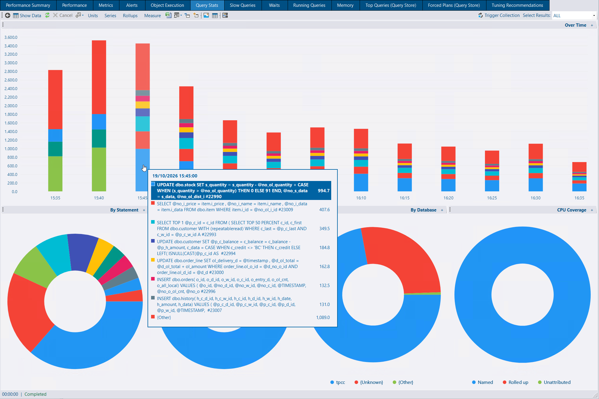](query-stats-charts.png)

[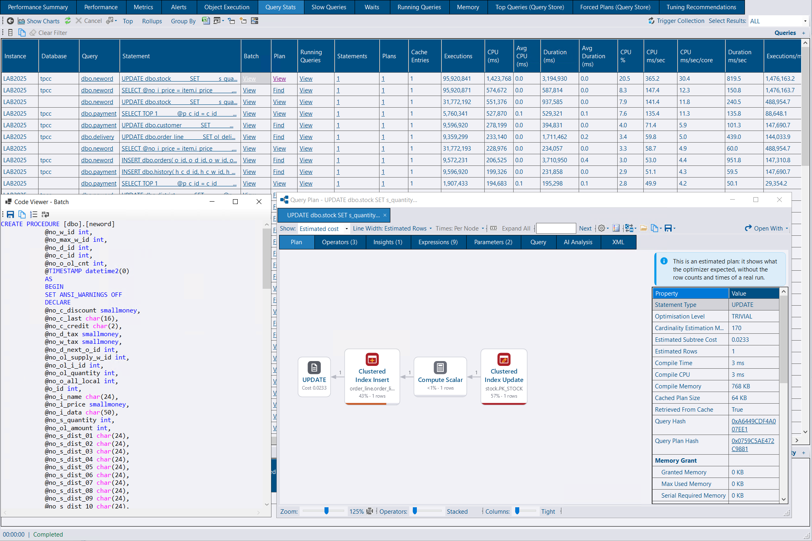](query-stats-data.png)

Object Execution Stats tells you which procedure did the work. Query Stats tells you which statement inside it, and it also captures ad-hoc queries, which never appear in Object Execution Stats.

A new collection reads statement-level CPU, duration, reads, writes, executions and the rest from the plan cache, and each instance and database gets a **Query Stats** tab for charts and a grid. It is off by default, because reading the plan cache costs whatever the cache costs. See [Query Stats](/docs/help/query-stats/).



The collection reads `sys.dm_exec_query_stats` every five minutes and stores the change since the last read, so the plan cache itself is not copied into the repository. The tab charts a measure over time and by statement, object and database, with a CPU coverage pie, and a grid you can group by query shape, statement or plan. At database level the By Database pie is hidden, and the coverage chart leaves out work that cannot be attributed to a database.

Set **Query Stats Top N** in the service config tool — on the new Query Stats tab when you add connections, with a link to apply the same settings to existing connections, or in the grid. Updating a connection keeps its Query Stats settings. The families that rank in the top N (and any with a single execution past the slow threshold) are kept in full. Everything else is rolled up, so the totals still add up to the work the instance did. A second result on the grid says how much of the window was covered, how much CPU was rolled up or could not be attributed, and how long the read took. A database whose work was rolled into the instance's {Other databases} row says so in the status bar, and so does a database that had nothing collected.

Ad hoc statements are grouped by database and query hash, with literal values and comments masked, and one variant kept as a labelled example. Module statements are identified by object and offsets, so a redeploy does not start a new history. Plans for the shapes that were stored are fetched afterwards, heaviest first, up to 50 per collection and once a day per shape. A plan that was not captured can be fetched from the cache through messaging, or with a generated script when messaging is not available.

Raw rows are kept for 30 days and hourly rollups for 365. Reports read whole hours from the rollup and the partial hours at either end from the raw rows. From the grid you can open Running Queries for the same query hash and time window, or jump to Query Store.

Object links, query hashes and plan hashes open the detail window described below.



## Detail window

[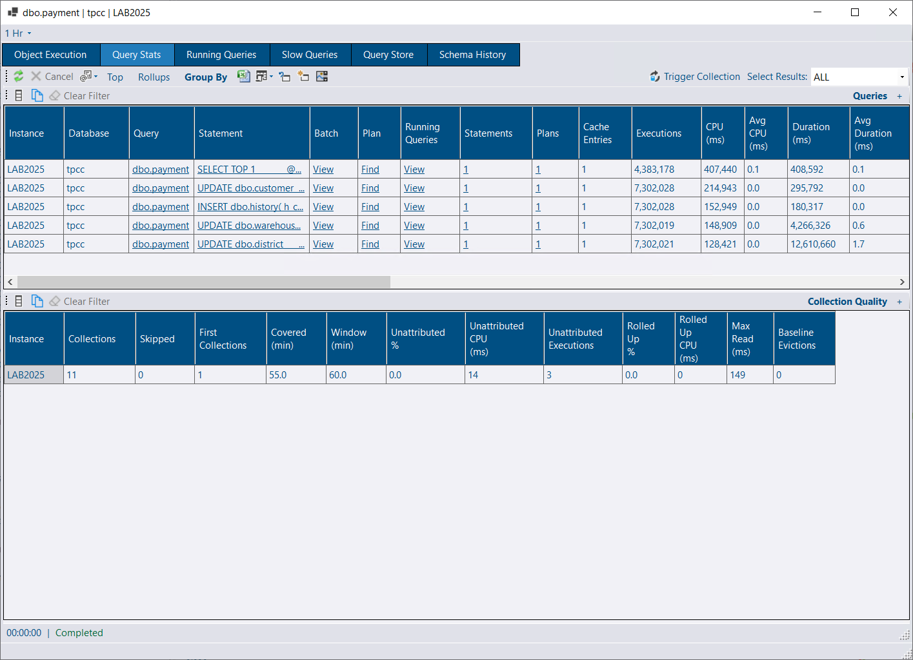](detail-window.png)

Clicking an object, query hash or plan hash opens one detail window, with the history for that item on tabs, instead of a separate popup for each place you came from.



An object — from Running Queries, Slow Queries, Query Stats or Object Execution — has tabs for Object Execution, Query Stats (its statements), Running Queries, Slow Queries, Query Store and Schema History, including a diff of DDL changes.

A query hash or plan hash opens the same window, with Query Stats, Running Queries and Query Store. It opens on Query Stats where that collection is on, and on Query Store where it is not.

Items you open one after another share one window, on document tabs, the same way session detail does. An item that is already open is brought to the front. Ctrl+click opens a new window, and Ctrl+W closes a tab. Each item keeps its own time window, shared by its tabs and independent of the global filter once the window is open.

Session detail gains a Query Stats tab for the running statement's query hash, and a Schema History tab when the session is running an object.



## Plan Viewer

[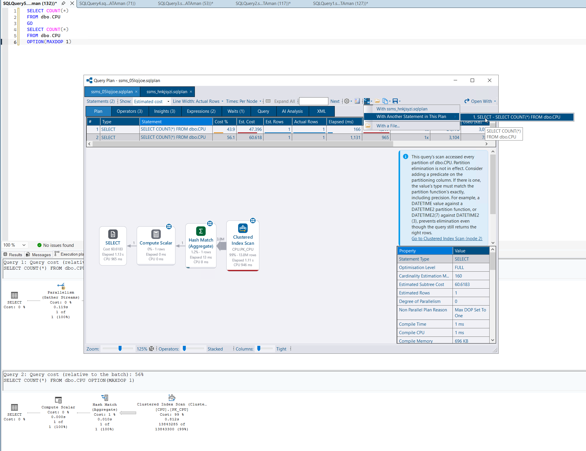](plan-statement-compare.png)

Seek, set and MERGE predicates that the plan already contained are now shown, and you can compare one statement in a plan with another. Information cards explain table variables and table-valued functions, where the optimizer is guessing.



Seek predicates are shown for clustered index update and delete, including the form of plan where the predicate sits directly on the operator and was previously missing. Insert, update and merge operators show their set predicate in the properties panel, the tooltip and search. A MERGE labels each predicate with its action.

Query hash and plan hash links open the detail window.

Right-click a statement in the statements grid to compare it with another statement in the same plan, or to open that statement on a tab of its own. **Compare > With Another Statement in This Plan** lists every other statement.

A table variable has no statistics. The card says how many rows the optimizer believed it held: compiled while empty and costed for one row, or compiled with a known count from deferred compilation, a recompile or a table-valued parameter. A statement that modifies a table variable always runs on one thread. For more than a few rows the card suggests a temp table, which has statistics and can be filled in parallel.

A user-defined table-valued function gets the same treatment: the work hidden inside the call, the return table with no statistics, and the fixed guess (100 rows, or 1 with the legacy cardinality estimator). The card says whether interleaved execution applied. A function called once per outer row is described as streaming, the same way a CLR function would.

Built-in functions such as `STRING_SPLIT`, `OPENJSON` and the DMVs are named on one card, with the one whose estimate was furthest out called out.



## Availability group failover history

[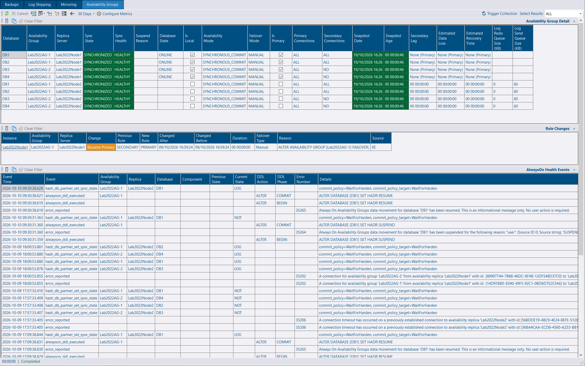](availability-groups.png)

The Availability Group tab records role changes, with an exact time and a reason when the `AlwaysOn_health` extended events session is running.



Each collection compares the local replica's role with the previous snapshot.

Where `AlwaysOn_health` is running, a new collection reads it every five minutes. The first run reads the files the instance already has, so the history is back-filled. Instances with no availability groups, or where that session is not running, are skipped and checked again hourly. A collection you trigger from the GUI always checks.

Those events give an exact time, a failover type (manual, forced or automatic) and a reason drawn from any monitored replica of the group: a failover statement, a health check error, the replica stopping, the HADR manager going offline, a lease expiry or a HADR error. Snapshot rows that an extended events row already covers are hidden. Instance restarts are not counted as role changes.

The tab has its own date range, defaulting to 30 days. The instance view lists the AlwaysOn health events. Events are kept for 365 days by default.



## Log Shipping

[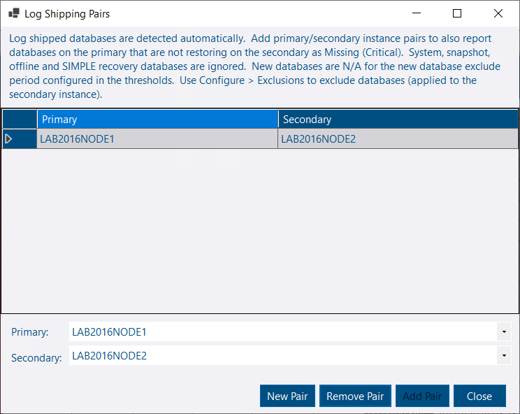](log-shipping-pairs.png)

A database that is restoring or in standby is already detected as log shipped. A database that should be log shipped and is not never appears on that list, so it never alerts.

Name the primary and the secondary as a pair and those missing databases are reported against the secondary. Databases you do not want monitored can be excluded, and they stay on the report so a pattern that matches more than you intended is easy to see.



**Configure > Log Shipping Pairs (Missing Databases)** on the Log Shipping tab. Databases on the primary that are not restoring or in standby on the secondary are reported against the secondary as **Missing** (Critical). System databases, snapshots, databases that are not online on the primary, and databases in SIMPLE recovery are ignored. A database created within the new-database exclude period — the same setting as the thresholds — is **Missing (New Database)** and does not alert until that period ends.

**Configure > Exclusions (Root)** applies to every instance. **Exclusions (Instance)** applies to the selected secondary, and an instance pattern wins over a root pattern. Enter one database name per line. `%` is a wildcard. An excluded database is **N/A (Excluded)** when it is restoring, or **Missing (Excluded)** when the pair says it is missing. **Excluded By** shows the pattern and whether it matched at root or instance level.

The summary **Missing** count is those missing databases. Excluded and new databases are N/A and are left out of it, and missing databases are not counted as log shipped. When log shipping metrics are collected, **Missing Database Count** is stored with them. The detail grid adds **Primary Instance** and **Excluded By**.

Without pairs, detection works as before. Pairs and exclusions need the App role, or administrator.



## AI Assistant

Amazon Bedrock is a provider, alongside Azure OpenAI, Anthropic and Ollama. After an analysis you can ask a follow-up, answered from the same snapshot the first answer used.

**AI Analysis** on the Performance tab, and on Performance Summary, analyses the instance you are looking at over the range selected. The dialog shows the figures that would be sent before anything is.



The request is built from the same data as the charts: instance context, CPU, waits, IO, performance counters, memory clerks, blocking, object execution, latches and spinlocks. You choose which sections go, how many rows each names, and whether each includes a time series. The window is the range you are viewing, capped at its last 7 days, and each section can be compared with the same window a week earlier.

On Performance Summary the button analyses the selected instance, or the only one when you are already at instance level. **Analyse performance with AI...** on a row does the same. The Latches and Spinlocks tabs have the same button, focused on those two sections.

Submitting uses the AI service. Anyone who can see the charts can preview the request, and **Copy prompt** puts it on the clipboard for an AI tool of your own. A follow-up keeps the figures the first answer was about. Nothing is stored after the dialog closes.





Set `AI:Provider` to `Bedrock`. The service calls the Bedrock Converse API, so any chat model on Bedrock works.

Leave the API key blank to use AWS credentials: a named profile, or the default chain (an IAM role on EC2, ECS or EKS, environment variables, or the default profile of the account the service runs as). Each call gets a short-term Bedrock key made from those credentials. A Bedrock API key works too, and takes priority over AWS credentials. The model picker lists the chat models available in the region, with the ID to configure. Bedrock is only used when you set the provider. It is not auto-selected. See [AI Assistant](/docs/help/ai-assistant/) for the settings, which model IDs to use, and the IAM permissions.

The follow-up is answered from the data, evidence and tool results the first answer was built from. The tools are not run again, so the conversation stays about that snapshot of the plan or deadlock. Ctrl+Enter sends the question, and the Raw tab shows the whole conversation.

If another AI service is listening on the default port and belongs to a different repository, the GUI uses the service registered for the repository you are connected to.



## Latches and spinlocks

[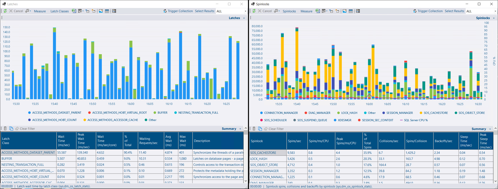](latches-spinlocks.png)

Latch and spinlock stats are for investigating contention on a particular instance. They are off by default, and most instances do not need them on. Highlighting is per core, so a large server is not flagged because one thread was waiting, and BUFFER is left to the Waits report.



Enable them in the service config tool. The suggested schedule is every minute.

The Latches tab charts wait time, with a summary of rates per second so a long range stays comparable. Wait time per core is highlighted at 50 ms/sec/core on average, and 100 for the peak: about one thread waiting on that latch class for every 20 cores. BUFFER is not highlighted. Its wait time is PAGEIOLATCH_* and PAGELATCH_* in the Waits report, and a busy server accumulates a lot of it from page reads alone.

The Spinlocks tab charts spins, backoffs, collisions or sleep time for the top spinlocks, with SQL Server CPU drawn over the columns. Spinning burns CPU in the SQL Server process, so spins rising with CPU is the pattern worth looking at. Names that Microsoft has published an explanation for include a description.

Both are collected for Azure SQL Database, at the scope of the SQL instance hosting the database, the same as waits. Databases in an elastic pool share an instance, so they show the same stats. Rates use the time each snapshot covered, including intervals where nothing waited, so a burst followed by idle minutes is not reported as if the burst lasted the whole hour.



## Collection schedules

[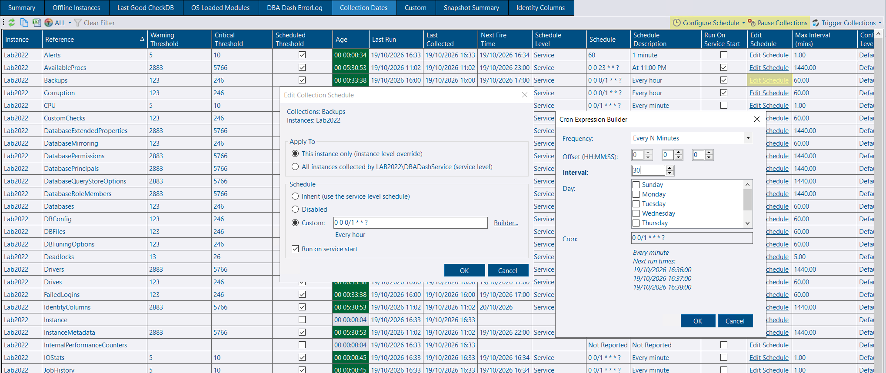](edit-schedule.png)

Schedules can be changed, and collections paused, from the GUI. Turn on **Allow Schedule Changes** in the service config tool.



The GUI only offers it on a service that accepts the change, and the user needs the **AllowScheduleChanges** role (or db_owner).

**Configure Schedule**, on the instance context menu and on Collection Dates, opens the same schedule dialog as the config tool. It lists every collection, including ones that are disabled and have never run. An instance change can be temporary, so you can switch a collection on while you investigate and have it revert on its own.

**Pause Collections** pauses scheduled collections for up to 31 days and mutes alerts for those instances. A collection you trigger by hand still runs. Paused instances are flagged in the tree and on the Summary tab. Pauses and temporary schedules survive a service restart and end by themselves. The service applies the change without a restart. The **User Actions** report records who changed what.

The Databases and Jobs folders in the tree can be filtered by name, the same way object folders already can.



## SQL login password age

[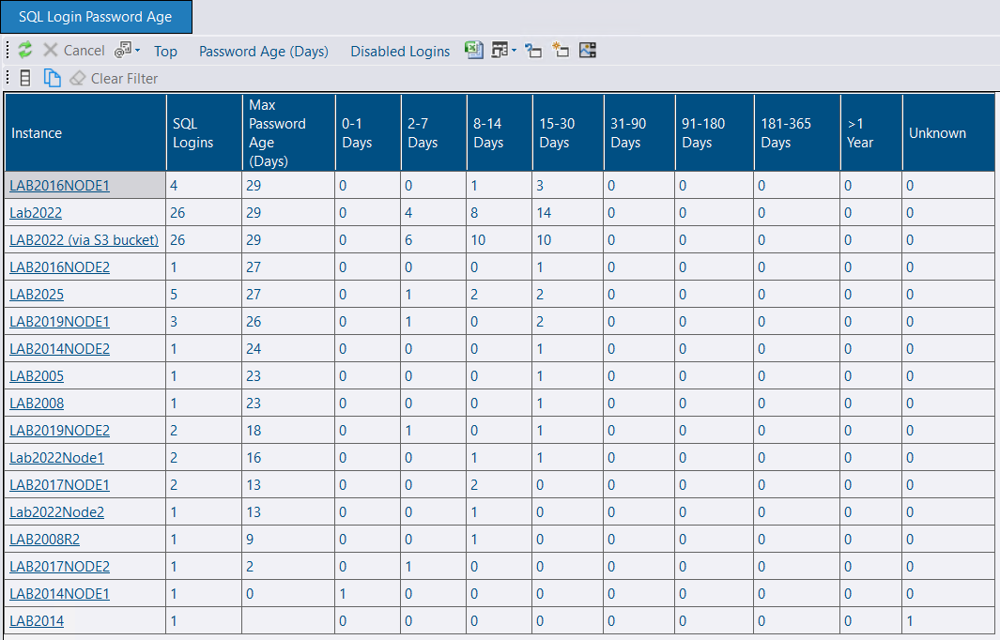](login-password-age.png)

SQL logins now record when the password was last set, and two reports show how old those passwords are.



The age comes from `LOGINPROPERTY`, as part of the existing principals collection. Values that SQL Server reports as unknown are stored that way. Data collected by an older agent imports with the column empty.

**SQL Login Password Age** summarises each instance: the oldest password, and how many logins fall in each age bucket from under a day through more than a year, plus unknown. **Oldest Passwords** lists the logins past a minimum age you choose. Disabled logins are excluded unless you include them.



## Memory

[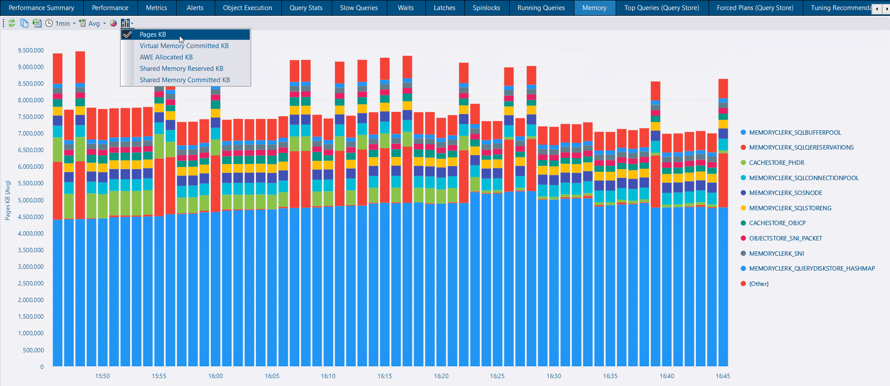](memory-clerk.png)

The Memory tab has a stacked column chart of memory clerk usage over time. The top 10 clerks are shown and the rest are grouped as {Other}. You can chart pages, virtual memory committed, AWE, or shared memory reserved or committed. The date grouping follows the selected range, as on the other stacked charts.

## Deadlocks

The deadlock markers on the Performance tab used the engine-wide **Number of Deadlocks/sec** counter. On Azure SQL Database that counter includes deadlocks that never touched the database you are looking at. Where the Deadlocks collection is enabled, the chart now counts the deadlocks DBA Dash stored.



The counts are exact, they are filtered to the database when you are at database level, and each point opens the Deadlocks report for the window it counted. **View > Deadlock Counts** switches back to the performance counter when you want the longer history from before the collection was enabled. The choice is saved with the performance view.

The first and last buckets are also kept inside the date range you asked for, so a point is not plotted before the axis starts and the drill-through does not include deadlocks that were not counted.



## Running Queries

[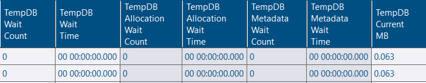](tempdb.png)

Tempdb page latch waits in the Running Queries summary are split into allocation contention (PFS, GAM and SGAM pages) and metadata contention (other pages), with a count and a wait time for each.

## Installers

The GUI has its own setup program, on the same lines as the Visualizer. An installed GUI offers to move to the version of the repository it connects to.



An installed GUI offers an update, or a downgrade when the GUI is newer than the repository. A copy you run from the zip still uses the upgrade script.

Both the GUI and the Visualizer can be installed for the current user or for everyone, under Program Files. An update of an install for everyone asks for administrator permission, and the prompt says so. The SSMS extension finds an all-users install.

**Upgrade** in the About box installs the repository's exact version, so a patch release can be picked up without waiting for a prompt. The prompt on connect is unchanged: it appears when the major and minor version differ.

The setup program shows a DBA Dash splash while it installs.



## Fixes

* **Object Execution Summary** and **Performance Summary** (CPU, IO and waits) read whole hours from the hourly rollup and the partial hours at either end from the raw rows. A window that did not start on the hour no longer drops its first partial hour, and a short window such as the last 24 hours no longer has to read every raw row. Each period in a comparison is split on its own.
* A time filter with a UTC offset that is not a whole number of hours (for example +5:30) reads the raw rows, because an hourly rollup row then straddles two local hours.
* IO Stats kept the larger read latency in the write latency column when it merged an hourly row. It now keeps the larger write latency. The Azure DB summary sample count includes the CPU histogram bucket it was missing.
* The Azure DB elastic pool graph loads again.
* Restoring a database under a temporary name, dropping the original and renaming no longer fails with a duplicate key in `dbo.Databases`.

## Release Notes

See the release notes for a full list of fixes and improvements:

- [4.22.0](https://github.com/trimble-oss/dba-dash/releases/tag/4.22.0)
