## Live query plans

[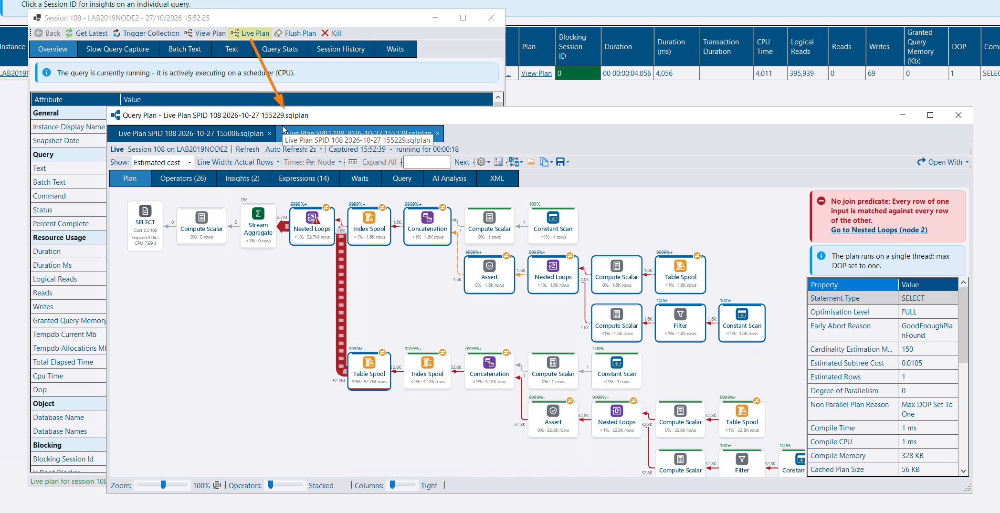](live-plan.png)

A query that is still running can be opened as a live plan, from Running Queries or from a results grid in SSMS.

[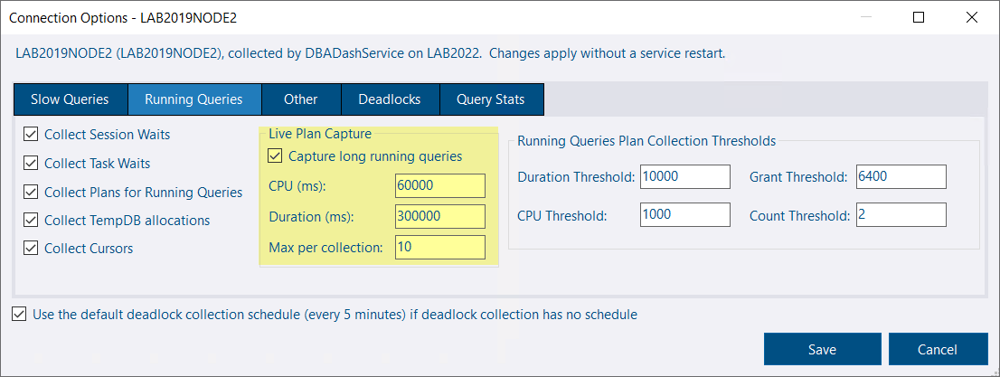](live-plan-capture-config.png)

[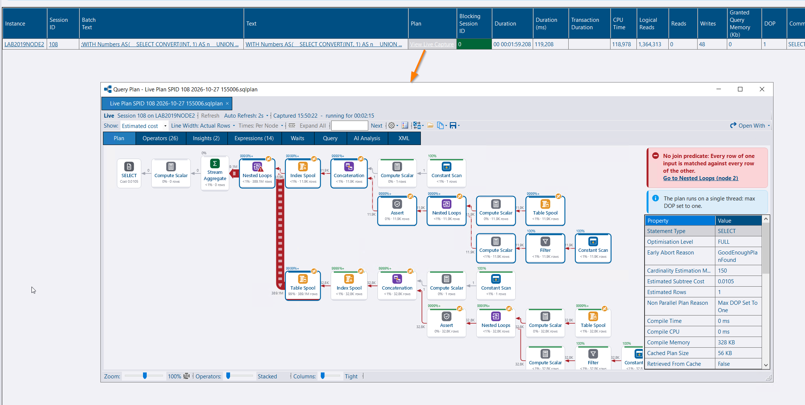](live-plan-capture.png)

Long-running queries can be collected as they run, so the plan can be opened later with how far each operator had got. The collection reads `sys.dm_exec_query_profiles`: a few small rows of operator counters. It does not read the showplan, and it does not store a plan XML on each snapshot. The counters are compressed into one row per request, statement and plan, and the next collection replaces that row while the query is still running. The plan itself is the one plan collection already keeps, once per plan shape. A plan you open live and follow on screen is not written to the repository at all. Each refresh of that view sends the same counters and writes them into the plan already open.



**Live Plan** on the session detail, and **Live Query Plan** on the Running Queries grid, are available for a running request on an instance with messaging. The **Messaging** role is required, the same as plan collection. The plan comes from `sys.dm_exec_query_statistics_xml`. **Refresh** (F5) and **Auto Refresh** (off, or every 2, 5, 10 or 30 seconds, defaulting to 2) are on the Live bar. Auto refresh pauses on a hidden tab and stops after 30 minutes, after three failures in a row, or when the query finishes. The last capture stays on screen.

Each refresh keeps zoom, selection and the properties grid where you left them. Operators that are moving rows are highlighted, with a progress strip against the estimate. Statements such as `WAITFOR`, `BACKUP` and `DBCC` have no plan. Otherwise lightweight query profiling has to be on for a live plan to be available. The request is read before and after the plan or the counters, and a capture is discarded if the statement changed while it was being read, so a MARS session or the next batch is not attached to the plan you were watching.

**Capture long running queries** is off by default. It takes a CPU threshold, a duration threshold and a maximum per collection. The defaults are 60 seconds of CPU, 5 minutes of duration, and 10 queries, highest CPU first. It only applies to queries that also meet the plan collection threshold, and a blocked query does not count towards the duration. The **Plan** link shows **View Live Capture** where one was stored. Each capture opens on its own tab, and **Refresh** follows the query live if it is still running. Captures are kept for as long as running queries. See [Running Queries](/docs/help/running-queries/#live-query-plans).



## From SSMS

[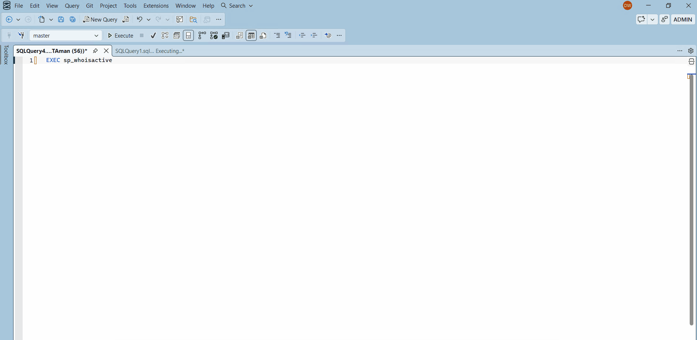](live-plan-ssms.gif)

Right-click a row that has a `session_id` or `spid` — `sp_BlitzWho`, `sp_WhoIsActive`, `sp_who2` and the same shape of result — and choose **Open Live Plan in DBA Dash Visualizer**. The viewer follows that request with the same refresh: the plan XML once, then operator counters as it runs.



The row is the one under the pointer. A right-click in SSMS does not select the row, so the extension hit-tests the grid, and uses the selection when the menu was opened from the keyboard. The session, and the request start time when the grid has a `start_time` or `request_start_time` column, come from that row, so a session that has moved on to another request is left alone.

The extension takes the query window's connection (Windows or SQL authentication; Microsoft Entra is not supported yet) and hands it to the app in a temp file protected with DPAPI for the current Windows user. Any password is removed from the connection string and protected again inside the file. The app only accepts these files from the extension's temp location, in the version it knows, and less than 10 minutes old. It connects itself and runs the same SQL the service uses for a live plan from the GUI. See [SSMS Extension](/docs/help/ssms-extension/#live-plans).



## Source connections

[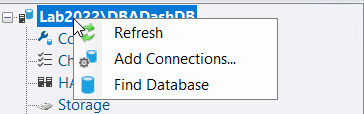](add-connections.png)

[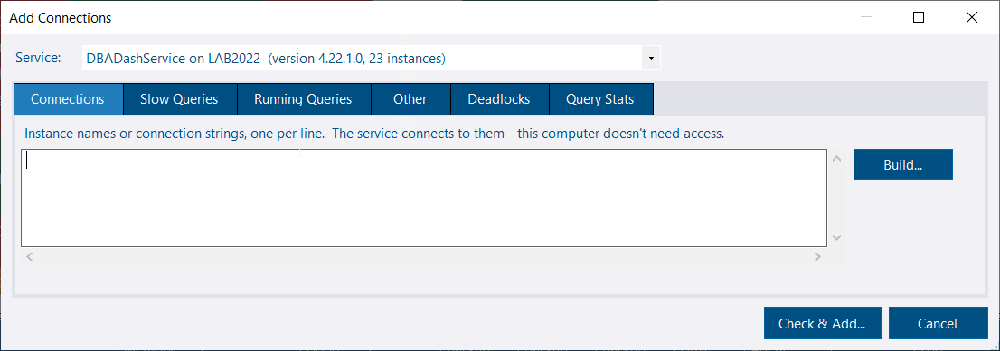](add-connections-dialog.png)

Source connections can be added, removed and edited from the GUI. The service checks each connection as the service account, writes `ServiceConfig.json` and starts collecting without a restart.



Turn on **Allow Connection Changes** in the service config tool. That also allows [schedule changes](/docs/help/schedule/#changing-schedules-from-the-gui). The user needs the **ManageConnections** role and the **Messaging** role. db_owner can do the same without either role. Messaging has to be enabled on the service. The **ManageConnections** role includes schedule changes.

**Add Connections...** is on the root of the tree. Pick the service (ones that accept connection changes, defaulting to the one collecting the most instances), enter the connection strings and set the same options as the config tool: slow queries, running queries, live plan capture, deadlocks, query stats and the rest. The computer running the GUI does not need to reach the instance. The connection builder can build a string without connecting, and the strings are encrypted for that service before they are sent. The service publishes an RSA public key; the GUI encrypts with AES-GCM and wraps the key with RSA, so passwords are not readable in the broker queue or in SQS. The private key stays in the service's memory.

The service connects as the service account and the review dialog shows the status, version, login and notes for each connection, including instances already collected by another service or marked deleted in the repository. Choose add, update, add anyway, add explicitly or skip for each row. Adding without a successful check is only offered for a row the check already reported as failed. If the service's own check then fails, that connection is skipped. Deleted instances can be restored from the same dialog. Custom collections are not part of an add from the GUI. SQL connections only. Databases and read replicas discovered from a new connection are scanned in the background.

**Connection Options...** on an instance reads the current options from the service and saves them back. The connection string, ConnectionID, schedules, custom collections and settings that are not among those options are kept. Databases and read replicas discovered from the connection get the same options. Extended events sessions the change leaves unused are dropped. A session you created yourself is left alone.

**Remove Connection...** removes the connection from the service config, including databases and replicas discovered from it, clears pauses and temporary schedules, and by default drops the DBA Dash extended events sessions and marks the instance deleted in the repository. The service waits up to two minutes for collections that already started before it drops those sessions, so a collection still running does not recreate them afterwards.

The config tool uses the same options tabs and the same review dialog when connections are added there.

Changes are recorded in the **User Actions** report. A source saved by an older version without a ConnectionID has to be given one before these messages will run: `DBADashConfig -a PopulateConnectionID`, then restart the service. See [Messaging](/docs/help/messaging/#source-connections).



## Job timeline

[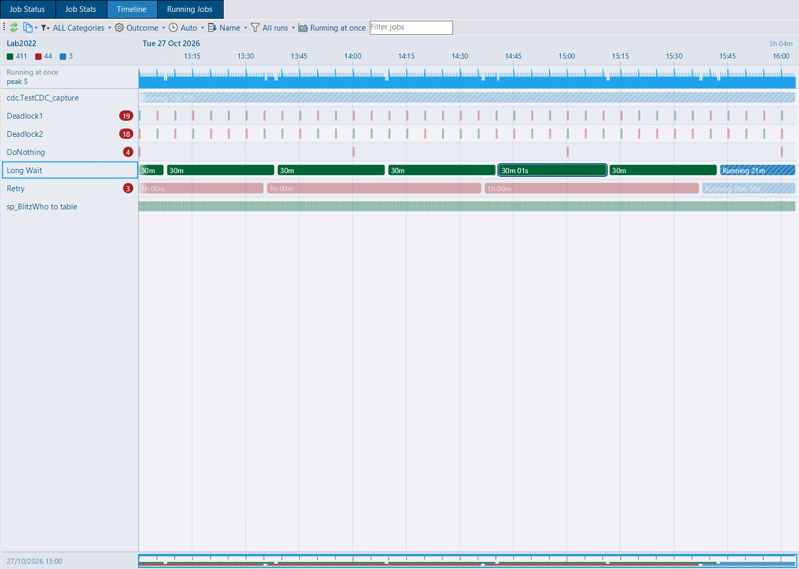](agent-job-timeline.png)

[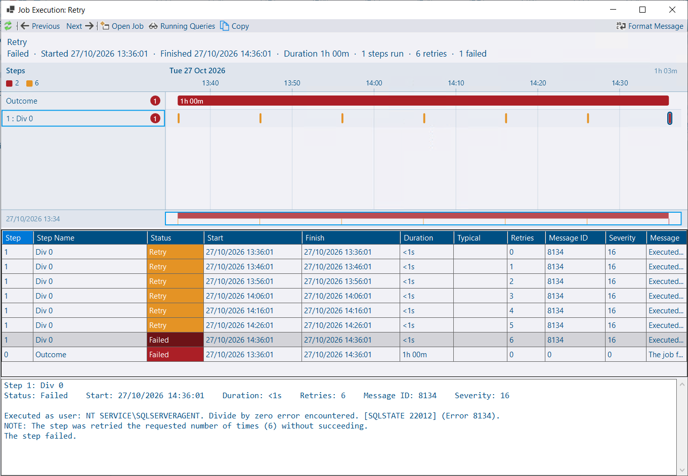](agent-job-timeline-execution.png)

The SQL Agent job timeline is drawn in the application, with its own zoom, pan and overview. The **Timeline** tab is also on the Agent Jobs node, for every instance in the folder at once.



Ctrl+wheel zooms, dragging pans, and dragging across the time axis zooms to that range. An overview strip shows the whole period. Hovering a bar shows the run. Running jobs are striped, and a line marks the current time. Status colours in the dark theme are lighter so a short run stays visible. The legend counts executions and shows or hides each status. Clicking a legend entry filters the chart. A job name filter and sort options (name, first start, total duration, failures) are on the toolbar.

**Auto** date grouping is the default. Runs closer together than the narrowest bar the chart can draw are merged, and a banner says so. When the zoom settles, the time in view is fetched again down to each run. A merged bar is coloured by the worst status it contains, and the legend, failure badges and tooltips still count each run.

On the Agent Jobs node each instance is a collapsed row of busy spans. Expanding an instance loads its jobs. Double-click a span to expand that instance. A **Running at once** band, on by default, shows how many jobs were running at the same time. The **Runs** menu can hide runs shorter than a chosen length, from 10 seconds to an hour, or show only problems (failed, retry, cancelled). Both filters are applied when the data is fetched.

Double-click a bar to open that execution: status, duration, a timeline of its steps, and every history row, retries included. **Previous** and **Next** move through the job's other executions. A **Typical** column is the average duration of the last 30 successful runs of that step, and a step at least twice typical and a minute longer is highlighted. **Running Queries** opens the snapshot for the run. Jobs that are still running are on the timeline, with in-progress rows in the execution window.

Zoom, scroll and expanded instances are kept when you refresh or come back to the same node.



## Config secrets

Passwords and the AWS secret key in `ServiceConfig.json` are encrypted with AES-GCM. On Windows, with config encryption off, the key is a random machine key stored in the config and protected with DPAPI for the local machine. With config encryption on, the key is derived from the config password, so the secrets stay portable with that password.



The previous obfuscation (`¬=!`) used a passphrase that is in the public source, so anyone with the file could decrypt it. Those values are still read. The service re-protects them on start, and the config tool does the same when it saves. An older build of DBA Dash cannot read the upgraded values, so keep the new build with the upgraded file.

Each secret gets its own nonce, so the same password on two connections is stored as two different values. A value that cannot be decrypted — a config copied from another machine, or a damaged value — does not stop the config from loading. Those connections are logged and left in the file to be entered again. The service does not collect them, and it will not start if the destination password cannot be decrypted. On Linux and other platforms without DPAPI, and with config encryption off, secrets stay on the old obfuscation.

**Export Config** in the config tool, and `DBADashConfig -a Export`, writes a copy for moving DBA Dash or as a backup. The copy can protect the secrets with an export password, or leave them out (`--NoSecrets`) so they are entered on the new machine. The config you are running is not changed. Copying an unencrypted file to another machine leaves the machine-key secrets unreadable. The config tool lists those passwords in one grid, with a connection test and an option to use one password for every connection with the same user. See [Config File](/docs/help/config-file/).



## Alerts

**Azure DB Space** and **Elastic Pool Space** are alert rules. Both can use the critical % max size or pool storage status you have already configured, a percentage threshold, or both — when both are set, both have to be exceeded, the same as drive space.



**Space Measure** selects used or allocated space. The defaults are used space for databases and allocated space for pools, because a database in a pool cannot grow once allocated space reaches the pool limit. Elastic pool alerts are raised against the master database instance that collects the pool stats, one alert per instance listing each pool over the threshold. Retired pools are left out.

SQL Agent alerts raised by DBA Dash now go to the notification channel group the rule is assigned to. Drive space, backup, Azure database space and elastic pool space alerts record the rule that supplied the priority, so the notes and the close behaviour match that rule when more than one rule in the group matches.



## Identity columns

[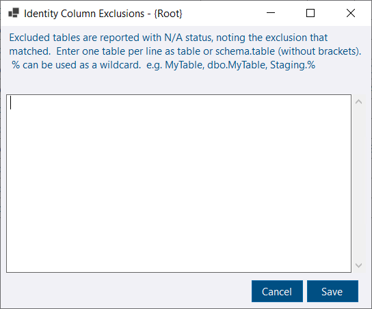](identity-exclusions.png)

Tables can be excluded from identity column monitoring at root, instance or database level. **Configure > Exclusions (Root)**, **Exclusions (Instance)** and **Exclusions (Database)** are on the Identity Columns tab, for the App role or an administrator.



Enter one table per line, as `table` or `schema.table`. `%` is a wildcard. `[` and `_` are matched literally, because they are valid in object names. An excluded table is reported with N/A status, and **Excluded By** shows the pattern and the level that matched, so the table stays easy to find while it is hidden from the warning counts. Exclusions override thresholds. The summary's max % used and estimated days ignore excluded tables, and an instance whose collected tables are all excluded shows OK. See [Identity Columns](/docs/help/identity-columns/#exclusions).



## Service Broker

[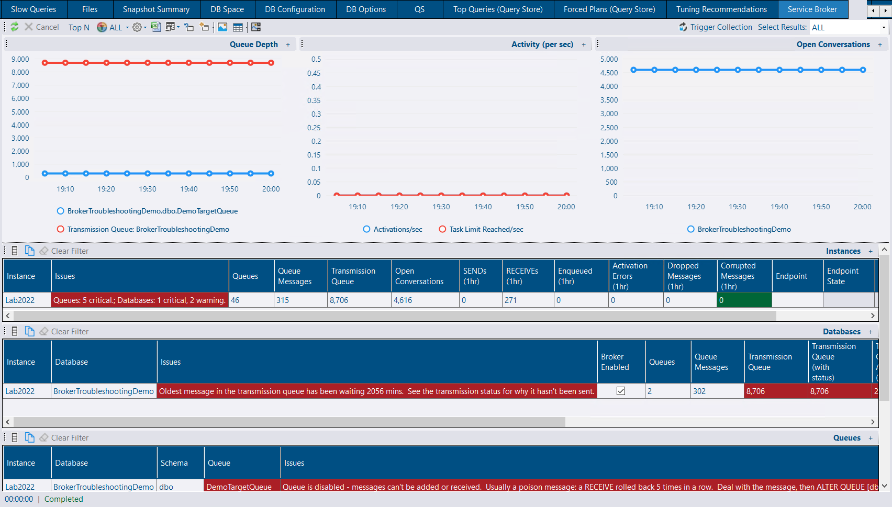](service-broker.png)

Service Broker can be monitored: queues, the transmission queue, conversations and the broker endpoint. The collection is off by default. The suggested schedule, once you turn it on, is every five minutes.



Online databases with Service Broker enabled are visited. Availability group secondaries are skipped. Queue depth comes from the queue's internal table. Queues that have messages are also read for the age of the oldest message waiting to be received, which shows a queue that is not being processed. A queue with retention on reports the count of messages still waiting, because retained messages would otherwise inflate the depth. `SqlDependency` queues are rolled into one row per database and schema.

The Summary tab has a Service Broker column. The Service Broker tab, on Checks and on a database, is shown when the schedule is enabled or a collection has already run. Turning the collection off leaves the tab while that collection date remains. It lists instances, databases, queues and the transmission queue, and charts queue depth, messages sent and received, and open conversations.

A queue that cannot receive, or whose status is OFF, is critical. That is usually a poison message. A missing activation procedure with messages waiting is critical. Activation that is disabled, or that has been notified for 10 minutes while messages are still waiting, is a warning. Queue depth and message age use thresholds. The root defaults are 10,000 messages, 15 and 60 minutes for the oldest queue message, 15 and 60 minutes for the transmission queue, and 100,000 open conversations. Set them from **Configure** on the tab, at root, instance, database or queue level.

A **Service Broker** alert rule can turn each of those checks on or off. A queue disabled more than 24 hours ago is left out of the queue alerts. See [Service Broker](/docs/help/service-broker/).



## Hardware

The Hardware tab highlights physical memory and max server memory when the figures sit outside what that edition of SQL Server can use.



Physical memory above the edition's buffer pool limit is a warning. A difference in the range often left for the operating system is information. Express and Web have the usual caps for the version, and SQL Server 2016 SP1 and later editions that gained the higher limit are treated that way. Azure SQL is left as N/A, because capacity there is the service tier.

Max server memory left at the default 2,147,483,647 MB is a warning. A value above physical memory is a warning, because it does not reserve RAM for the operating system. On a server with 16 GB or more, a value of half the physical memory or less is information, unless it is already near the edition cap. A lower setting can be deliberate when several instances share the server.



## AI Assistant

A shared AI service listens on HTTPS. With no certificate selected, the service creates a self-signed certificate and registers its thumbprint in the repository. GUI clients accept that certificate, or a certificate Windows already trusts for the service host. You do not have to install a certificate or put a reverse proxy in front of the service to turn HTTPS on.



**Use HTTPS** is on the AI Service tab of the service config tool, next to the port. **Certificate** lists the Local Computer Personal store, or **Automatic (self-signed)**. A certificate from the store should match the host in the service URL, and the AI service account needs permission to use its private key. The self-signed certificate is kept in `%ProgramData%\DBADash\AI` and lasts two years. The thumbprint is registered with the service URL, and each GUI keeps that pin for the service's host and port.

Turn **Use HTTPS** off when a reverse proxy already terminates TLS. Keep the proxy's `https://` URL and write the proxy port in it. An `https://` service URL with an explicit port other than the listener, and **Use HTTPS** left unset, is treated as that existing proxy setup and the service stays on HTTP. A URL with no port is not: the registered URL uses the listen port, and the service listens on HTTPS. `Security:Enabled` and `Security:RequireHttps` are not read. An existing Kestrel endpoint or listen URL is left as it is. Local mode, with no service URL, stays on HTTP and binds to localhost.

`Bedrock:Url` sends Converse calls to a gateway or proxy in front of Amazon Bedrock. Set it to the full URL. `{model}` in the URL is replaced with the model ID. With an API key set, `Region` can be left blank. The model list is skipped, and the configured model is used. Without an API key the region is still required, because the short-term key is signed with it. See [AI Assistant](/docs/help/ai-assistant/#sharedrepository-mode).

Plan and deadlock analysis can only be submitted by someone who can use the AI service key. A user without the **AIUser** role can still preview the request and copy the prompt. **Submit** and follow-up questions stay disabled, and the status line says so.



## Log shipping

[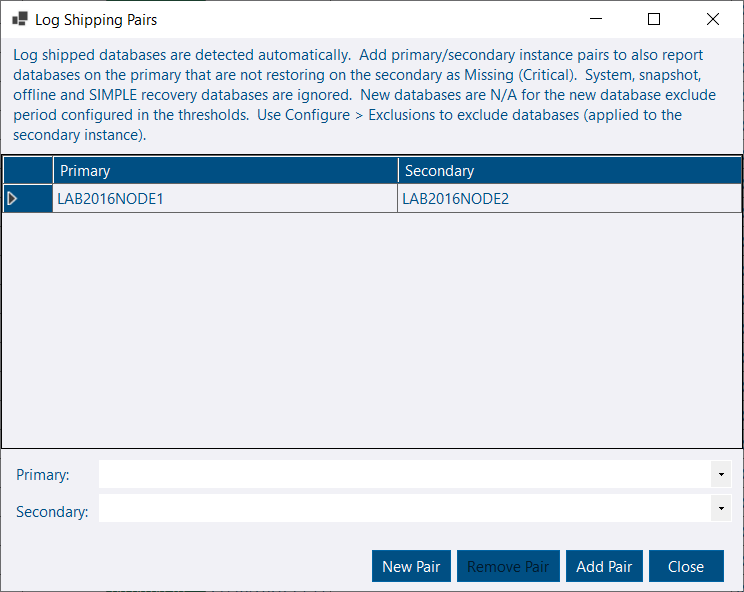](log-shipping-pairs.png)

The summary names the configured primary, and counts databases still inside the new-database exclude period. **Set Primary** is shown for an instance that has log shipped databases and no primary configured. It opens the pairs dialog with that secondary selected. An instance whose log shipped databases are all N/A — excluded, or with thresholds disabled — stays on the summary with N/A status, so the missing primary is visible. The report reads the status once for both the summary and the detail.

## Other changes

* Azure SQL Database nodes in the tree load their child nodes when the node is expanded, the same as a regular instance. With thousands of databases, closing the GUI, refreshing, searching and regrouping no longer builds every child up front.
* Toolbar text boxes, including the job timeline filter, use a background that stands out from the toolbar in the dark theme.
* Query Stats and spinlock collection are skipped on SQL Server 2005. Query Stats uses `DATETIME2` and `query_hash`, and `sys.dm_os_spinlock_stats` was added in SQL Server 2008.

## Fixes

* Importing availability group health events failed with a collation conflict when the server collation differed from the repository collation. Temp table character columns in the database project now use the database collation.
* The log shipping report was evaluated twice per refresh and scanned thresholds and exclusions per database. It is evaluated once, and those lookups seek.
* On the backup summary, the diff and log password-protected counts were counting full backups. They now count the diff and log backups.
* The backups report reads backup status once for the summary and the detail. The summary groups by instance and looks up instance thresholds with a seek, which keeps the memory grant in line with the number of instances.

## Release Notes

See the release notes for a full list of fixes and improvements:

- [4.23.0](https://github.com/trimble-oss/dba-dash/releases/tag/4.23.0)
