## MCP server

[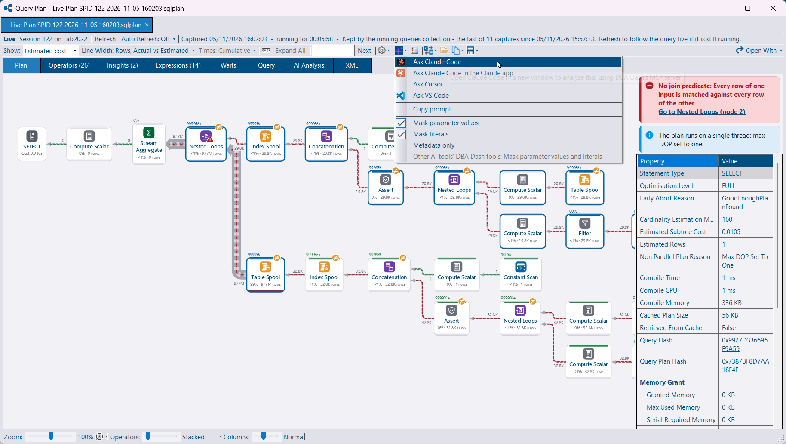](mcp-analysis.png)

An MCP server lets Claude Code, Claude Desktop, Cursor, VS Code and Windsurf query the repository with their own model. The tools are read-only. They use the same summaries as the AI Assistant, plus a deadlock, a query plan or an instance's performance. DBA Dash does not call a model, so no AI provider is required for this.

[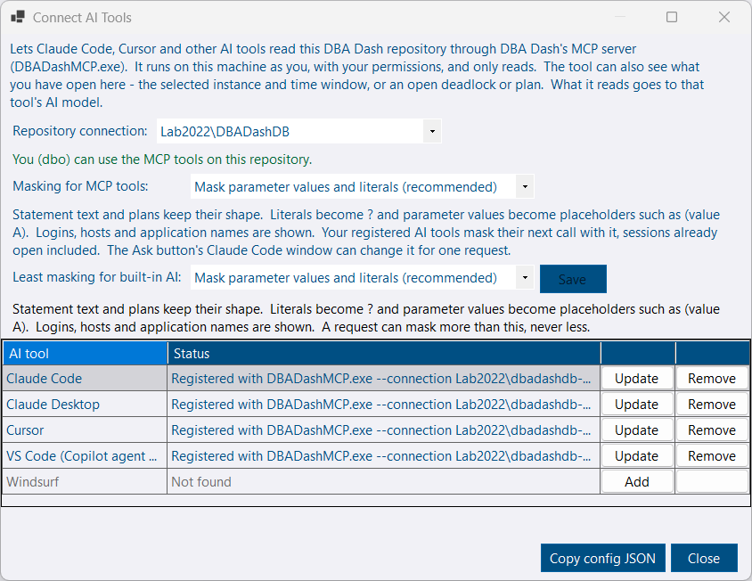](connect-ai-tools.png)

**Options > Connect AI Tools (MCP)** registers `DBADashMCP.exe` with the tools installed on the machine. The exe ships beside the GUI. It connects with the saved GUI connection, as you, and needs the **McpUser** role (or db_owner). The AI service can serve the same tools at `/mcp`.

An **Ask** button beside **AI Analysis** hands the open deadlock, the plan statement, or the instance on the Performance tab to one of those tools. See [MCP server](/docs/help/mcp/).

[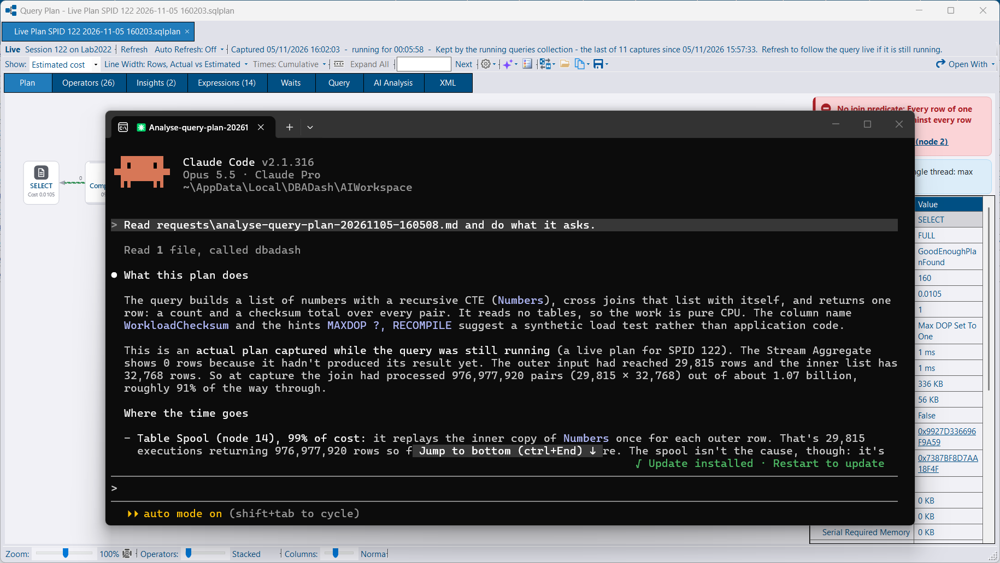](claude-code-analysis.png)

You can also start from the tool itself. In Cursor, ask about an instance and it reads the repository through the server you registered.

[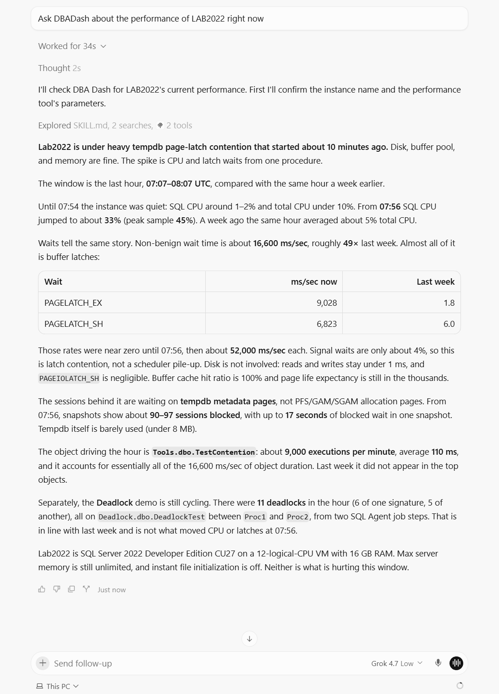](cursor-mcp.png)



The local server can read what the GUI is showing: the selected instance, tab and time window, and a deadlock or plan open in a viewer, including one opened from a file. That is published on a named pipe only your Windows user can open.

Masking is on by default. Parameter values and literals in plans, deadlocks and query text are replaced before a tool result is returned. The same menus offer parameter values, literals, or metadata only. A change in **Options > Connect AI Tools** is read on the next call, including sessions already open. Ask pins the masking for that request so a later Ask does not change a session that is already running.

File tools read only `.sqlplan`, `.xdl` and `.xml` files, under DBA Dash's folder or the folders the client allows.



## Job timeline - Planning

[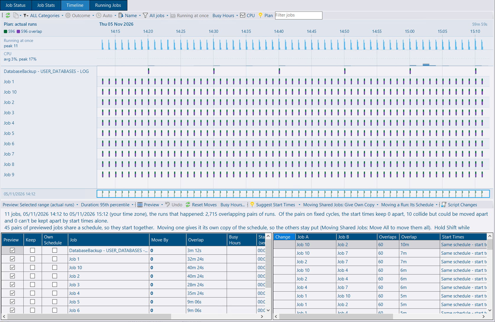](timeline-plan.png)

**Plan** mode on the job timeline shows where SQL Agent jobs overlap and lets you try start times that keep them apart. **Suggest Start Times** looks for smaller overlaps. You can also type a move, or drag a run to move the schedule that started it. **Script Changes** writes one script. Set `@Rollback` to `1` to undo it. Nothing is run on the server from the timeline.

A job that shares a schedule gets its own copy, so its start time can move without the other jobs. **Move All** keeps the shared schedule and moves those jobs together.

Runs that are too close together at the current zoom are drawn as a band. Zoom in to see each run. Expected durations come from the runs a schedule started.

[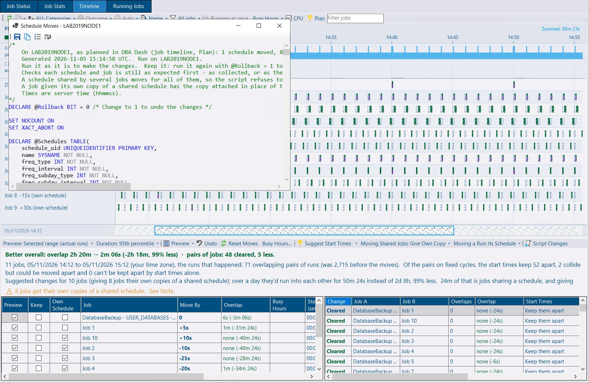](timeline-suggest.png)

### Busy hours

[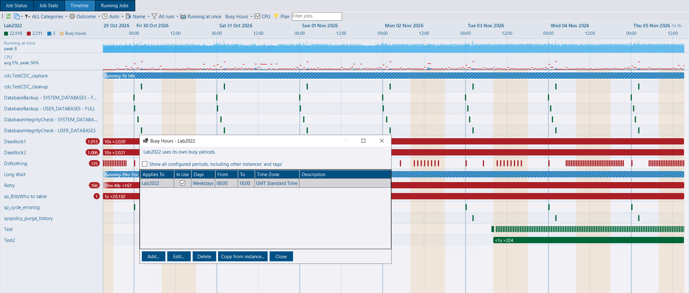](timeline-busy.png)

Busy hours are the parts of the week you would rather keep free of jobs, such as weekdays 9:00–17:00. **Suggest Start Times** keeps jobs out of them when **Keep Out of Busy Hours** is on, which it is by default. That only applies to a job whose runs can fit outside. A job that runs every minute is left as it is. Dragging a run does not avoid the period.

They can be set for one instance, a tag, or every instance. The most specific level that has any rows is the one used, so an instance can be the exception to its tag. The timeline shades them, and plan mode counts the runs that fall inside. **Busy Hours...** opens the editor. A new period defaults to weekdays 08:00–18:00.

## Community tools

[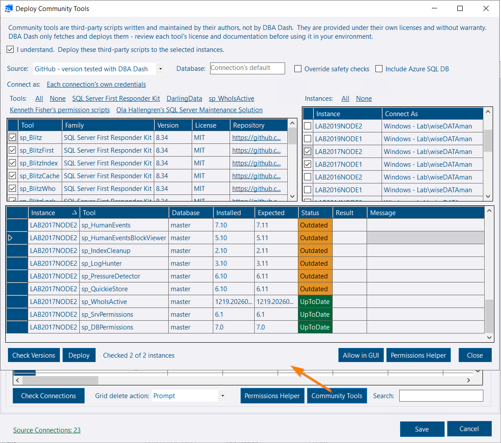](community-tools-check.png)

DBA Dash can deploy and update the community tools it runs: the First Responder Kit, DarlingData, sp_WhoIsActive and Kenneth Fisher's permission scripts. Each build pins a release. The scripts are fetched when you deploy them. They are not shipped in the installer.

The test for a pinned release is that it deploys and that the version can be read from the procedure definition. The procedures are not executed. A newer upstream release is given the same check on SQL Server 2022 before the pin moves. That is a check of the deploy, not of what the tool does when you run it.

**Community Tools** is on the service config tool, beside Permissions Helper, and **Deploy Tools...** is beside Allowed Scripts. Pick the tools and the instances, check what is installed, then deploy. The connection is yours, not the service account. Afterwards the dialog can add the tools to Allowed Scripts and open the Permissions Helper to grant EXECUTE.



**Pinned** (the default) downloads that release from GitHub and refuses a hash that does not match. **Latest** takes the newest release, with no hash check and without the deploy check above. **Folder** uses scripts you have already downloaded, for a server without internet access.

Checking and deploying follow the same lookup SQL Server uses for an `sp_` procedure: the database the connection lands in, then master. An update changes the copy DBA Dash will actually run. A tool that is not installed goes in the connection's database, so a second copy is not added in front of one in master. Azure SQL Database has no lookup in master, so the connected database is the only place the tools can go. Azure SQL Database is skipped unless you tick **Include Azure SQL DB**.

Version checks read the procedure definition. They need VIEW DEFINITION and do not execute the tool. The command line actions are `ListCommunityTools`, `CheckCommunityTools` and `DeployCommunityTools`. Deploy needs `--AcceptDisclaimer`. See [Community Tools](/docs/help/community-tools/#deploying-from-dba-dash).



[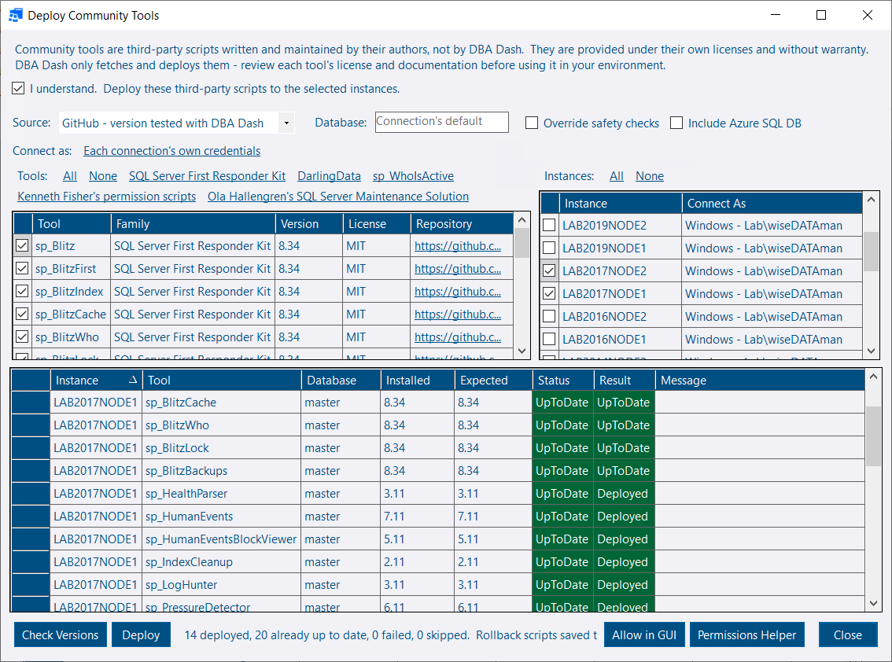](community-tools-deploy.png)

### Ola Hallengren's Maintenance Solution

The same dialog can deploy [Ola Hallengren's Maintenance Solution](https://ola.hallengren.com/): CommandExecute, DatabaseBackup, DatabaseIntegrityCheck and IndexOptimize, plus the CommandLog, Queue and QueueDatabase tables. No Agent jobs are created. DBA Dash does not run these procedures, so they are not selected by default and are not added to Allowed Scripts.

A procedure is replaced only when its definition is Ola's. A copy that does not match a known release is **Modified** and is left alone. When parameters change, Agent job steps that call the procedure are checked, and a job that would break blocks the update. The procedures are updated as a set. A rollback script is written before anything is replaced.

## AI analysis

Performance analysis now includes running queries and tempdb, and deadlocks over the same window. The model can ask for a few lookups before it answers: root blockers, queries waiting on a wait type, long-running queries, and one deadlock signature. The lookups use the same procedures as the MCP tools. A checkbox on the dialog turns them on. See [AI Assistant](/docs/help/ai-assistant/#performance-analysis).

Masking applies to the built-in AI service as well. `AI.DataDetail` is the minimum. A request can mask more, never less.

## Query plans

Comparing two plans defaults to every statement when a plan has more than one. Times, reads, costs and counts are totalled, so a procedure rewritten into several statements can be compared as a whole. Comparing two statements inside one plan is unchanged. See [Compare plans](/docs/help/query-plan-viewer/#compare-plans).

[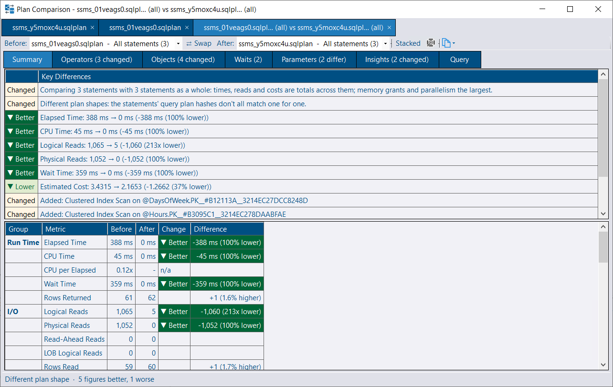](query-plan-compare.png)

The XML editor has find (Ctrl+F).

[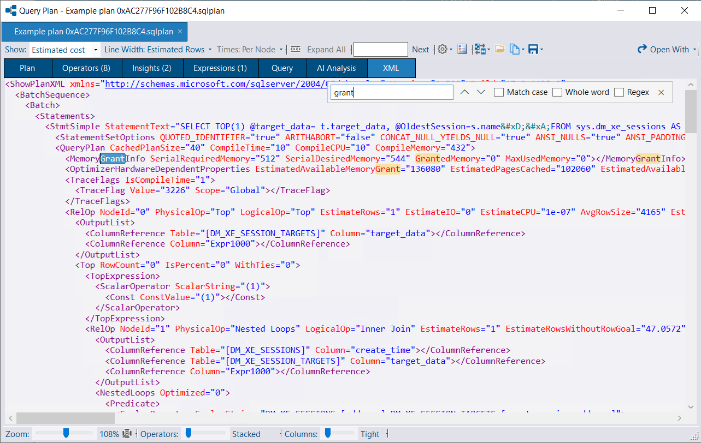](query-plan-search.png)

**View Operator XML** on an operator shows that operator's showplan XML.

[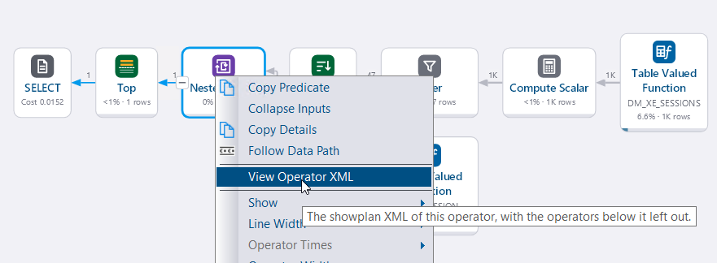](query-plan-operator-xml.png)

Live plan capture skips a statement that has only just started. The CPU and duration thresholds are on the request, which can span many statements. The current statement is bounded by the transaction start (and DOP for CPU) and is left until it can meet the threshold.

## Also in this release

* Log shipping treats a **RECOVERING** secondary database as present when it has a recent restore. A database that exists on the secondary but is not restoring or standby is **Conflict** (Critical). The detail grid adds **Create Date** and **Database Age**.
* **Add Connections** can open the Permissions Helper for connections that could not connect, and masks passwords in the connections box. The helper grants EXECUTE on the First Responder Kit procedures that `sp_Blitz` version-checks, where those procedures exist. A name such as `.` or `localhost` is resolved to the service's host.
* Object execution stats aggregate in stages, and the Performance tab charts load off the UI thread. A chart shows **Loading...** once a load has run for half a second.
* A LiveCharts drawing surface that did not match its canvas is fitted and redrawn, so a chart is not left on empty axes.
* Concurrent inserts of the same query text no longer violate `PK_QueryText`.
* In local mode the AI service only answers a request whose host is a loopback name.

## Bug fixes & minor changes

See the release notes on GitHub for the full list:

- [4.24.0](https://github.com/trimble-oss/dba-dash/releases/tag/4.24.0)
