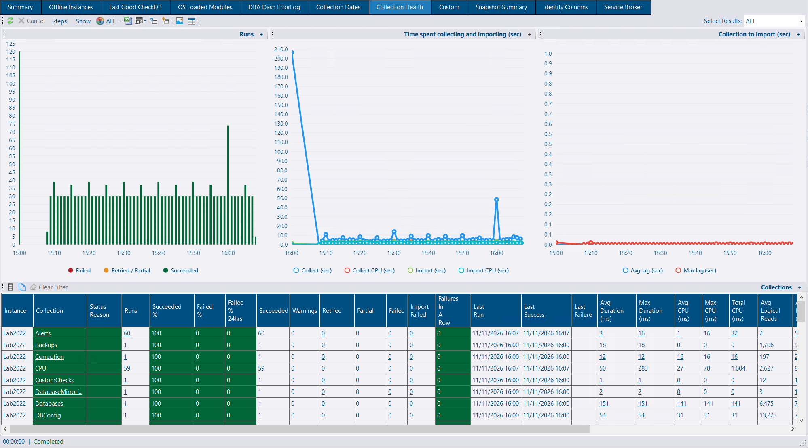
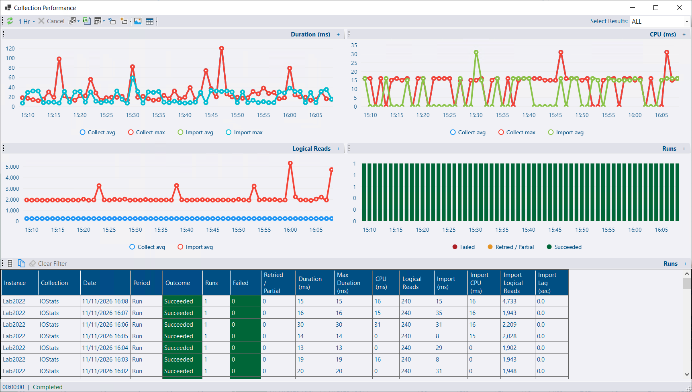
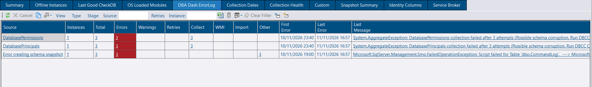
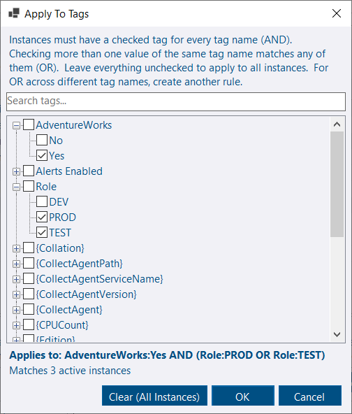
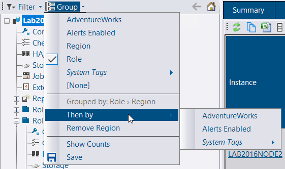
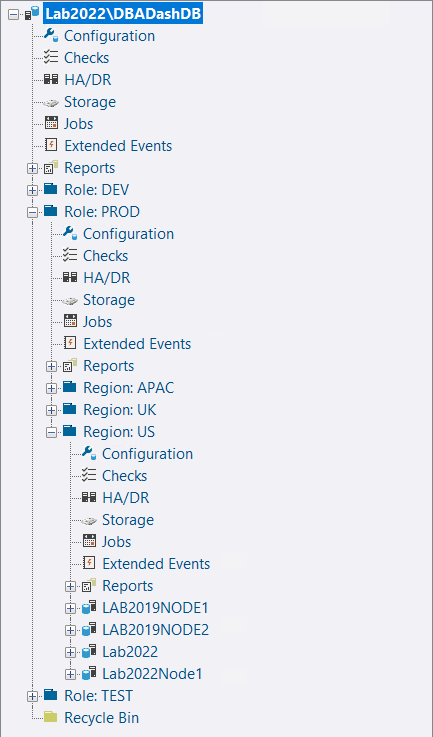
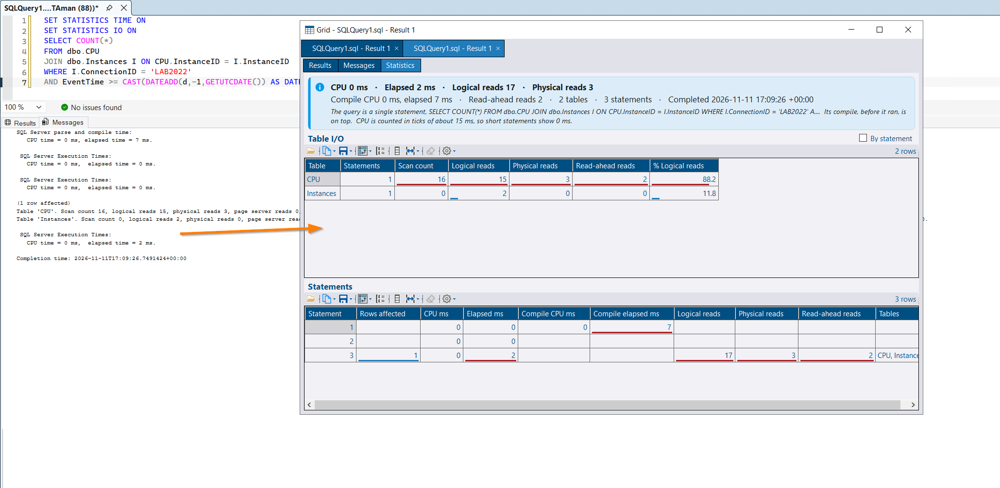
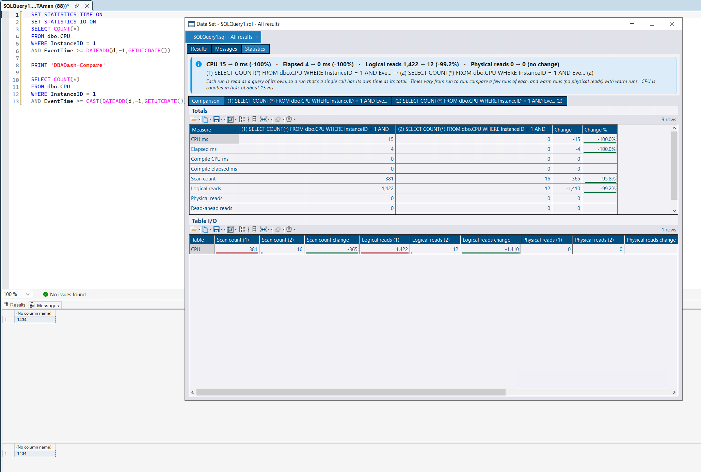
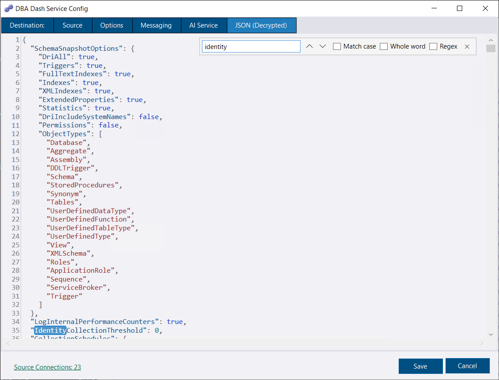


**Defaults have changed for new connections.** Slow query capture, query plans for running queries, live plans, query stats and the deadlock session are now on when you add a connection. Existing connections keep their settings. Check the new defaults in [New connection defaults](/docs/setup/options/#new-connection-defaults), or save your own.


## Collection health

DBA Dash now records whether each collection succeeds, not just whether it ran. The **Collection Health** tab under the **Checks** node shows how often each collection succeeds, its status and why, how long it takes, and how long its data waits to be imported.

### Less noise on the summary

The summary used to mark an instance critical whenever a collection's last attempt failed. The **Collection Health** column now looks at the pattern of failures. It only raises a status when failures keep happening, or when a high share of recent runs fail. Thresholds can be changed for a collection, an instance or both. See [Collection Health](/docs/help/collection-health/) for the details.

### Collection Cost

Every collection now reports its hourly performance data, including how long it takes, with no configuration needed.

Turn on **Log Internal Performance Counters** for more detail. Previously it recorded how long each collection took. It now also records the CPU and logical reads each collection uses, on the monitored instance and in the repository.

A new **Collection Performance** report shows a summary for each collection, with charts you can drill into to see each run, or each hour. Click a collection on the Collection Health tab to open it.

See [Cost](/docs/help/collection-health/#cost) for details.

### DBA Dash ErrorLog

The **DBA Dash ErrorLog** now opens with a row per instance, instead of a row for every error. Finding which instance is failing no longer means scrolling through every error. Click an instance, a source or a count to drill down to the errors behind it. When several collections on one instance fail with WMI errors, a card suggests checking WMI access.

## Alert rules and blackouts for several tags

**Apply To (Tags)** on an alert rule or a blackout period now opens a tag picker where you can choose more than one tag. Tags with different names must all match, and values of the same tag are alternatives. For example:

`(Role:Production OR Role:UAT) AND Region:APAC`

The picker shows the expression and how many active instances match it. **Add Blackout** from a rule copies the rule's tags. For OR across different tag names, use more than one rule, as before. Rules and blackouts with a single tag are stored as they were.

Rule scope and blackouts are now resolved once per alert run rather than for every rule and instance in every alert procedure. With 2,000 instances and 180 rules that step went from about 1,250 ms to 360 ms CPU per run. A blackout for all instances and all alerts now stops the whole alert run. Before, that check never matched, so alerts were muted per instance but the run continued. See [Alerts](/docs/help/alerts/).

## Group the instance tree by up to three tags

Once the tree is grouped by a tag, **Group > Then by** adds another level inside it, such as Role and then Region. Up to three levels are supported, and the menu has an item to remove the last level. **Show Counts** counts distinct instances at every level.

The saved layout still stores the first level the old way, so an older GUI opens it grouped by that tag. See [Tagging](/docs/help/tagging/#grouping-and-filtering).

## New connections collect more by default

New connections added in the service config tool or the GUI's **Add Connections** dialog start with more collections turned on:

| Option | Default for new connections |
|---|---|
| Slow queries | On, **10 second** threshold, **EventFile**. Azure SQL DB and Managed Instance connections are saved with RingBuffer |
| Running queries | Session waits, task waits, TempDB allocations and cursors |
| Running query plans | On, default thresholds |
| Live plan capture | On, default thresholds |
| Deadlocks | Dedicated `DBADash_Deadlocks` session with backfill. **Skip on Azure SQL DB** is checked |
| Query stats | On, Top N 50, 50 plans per collection |

The slow query threshold is 10 seconds rather than 1 because capture is now on by default, and storage grows with every execution over the threshold. Query stats covers the statements below it. Ticking the box by hand still fills in 1000ms.

Azure SQL Database connections are added with deadlock capture off, because the Azure DB scan copies the master connection's settings to every database, each with its own session. See [Deadlocks](/docs/help/deadlocks/).

**Save as my defaults** on the **Other** tab saves your own defaults to `%LocalAppData%\DBADash\NewConnectionDefaults.json`, and **Reset to app defaults** removes them. Existing connections aren't changed, and `DBADashConfig` defaults are unchanged. See [New connection defaults](/docs/setup/options/#new-connection-defaults).

## SSMS extension - STATISTICS IO and TIME

With SSMS 22, **Open in DBA Dash Visualizer** and **Open All Results** now bring the query window's messages and query text with the results. **Open Messages in DBA Dash Visualizer** on the Messages tab sends the messages alone.

The document has **Results**, **Messages** and, when `SET STATISTICS IO` or `TIME` printed anything, **Statistics** tabs. Statistics has a card with the query totals and a note on how far they can be trusted, table I/O by table or statement, and time, rows and reads per statement, with data bars. A single procedure call, `sp_executesql` or statement takes its own execution time as the total, so nested times aren't counted twice. A query with several calls shows a range, with a warning.

`PRINT 'DBADash-Compare'` (or `PRINT 'DBADash-Compare: label'`) splits a query into runs to compare: a card with the first run against the last, and a **Comparison** tab with totals and per-table I/O side by side. **Compare Statistics With** on a document tab's right-click menu compares runs from other tabs.

**Save Results and Messages...** saves an XML file that reopens on the same tabs. The Messages tab uses the code editor, with find (Ctrl+F). See [SSMS Extension](/docs/help/ssms-extension/#statistics-io-and-time).


The statistics tab was inspired by [Richie Rump](https://github.com/Jorriss)'s [Statistics Parser](https://statisticsparser.com/?lang=en), which also has a [SSMS extension](https://github.com/BrentOzarULTD/StatisticsParserExtension). Thanks to Richie for the idea.


## Service config tool

* The **JSON** tab uses the code editor, with syntax highlighting, line numbers and find (Ctrl+F, F3 / Shift+F3).
* Deploying the repository database shows its progress as it runs, instead of only when it has finished.

## Also in this release

* AI analysis works with Claude Sonnet 5.5, Opus 5.5 and other newer models, which returned a 400 error because temperature was always sent. DBA Dash no longer sends temperature or thinking settings. `Anthropic:MaxTokens` now defaults to 16000 (capped at 32000), as thinking counts against it, and the request timeout is 240 seconds. See [AI Assistant](/docs/help/ai-assistant/#anthropic-direct-or-via-azure-foundry).
* `sp_ineachdb` is deployed with `sp_Blitz`, which calls it, including on Azure SQL Database. Ticking a community tool to deploy also ticks the tools it needs. See [Community Tools](/docs/help/community-tools/#deploying-from-dba-dash).
* Following a link to a tab that's already loaded for the same instances (for example **Agent Jobs** on the Summary tab) refreshes it, rather than showing stale data. Back and switching tabs still keep the view, filters and customizations.
* The code editor follows the dark theme for plain text, as it does for SQL.
* The slow query capture mode and IO level options no longer reset to their first item when a connection's options are loaded before the form is shown.
* An instance with a blank tag no longer causes an error (4.24.1).
* Inserting the example query text for a query hash is done outside the `QueryStats_Upd` transaction (4.24.1).

## Bug fixes & minor changes

See the release notes on GitHub for the full list:

- [4.25.0](https://github.com/trimble-oss/dba-dash/releases/tag/4.25.0)
- [4.24.1](https://github.com/trimble-oss/dba-dash/releases/tag/4.24.1)
