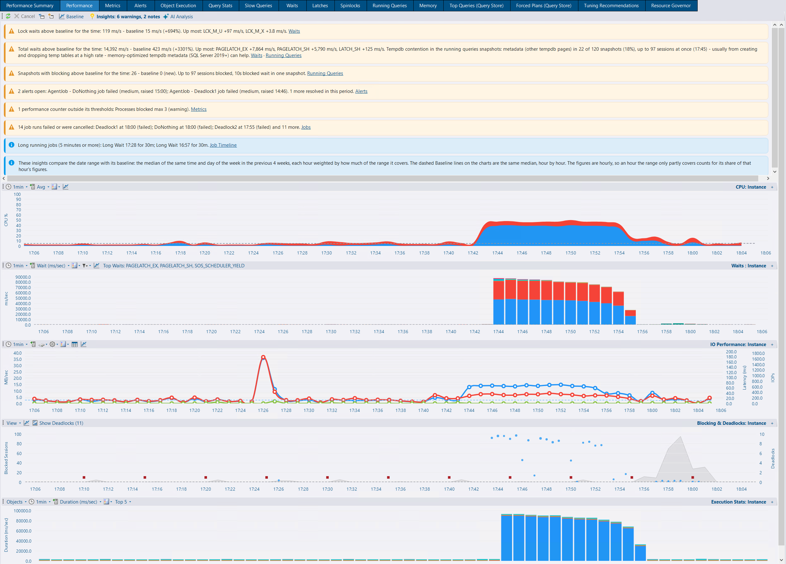
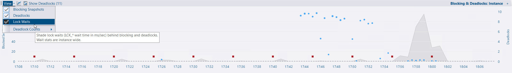
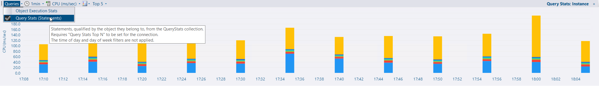
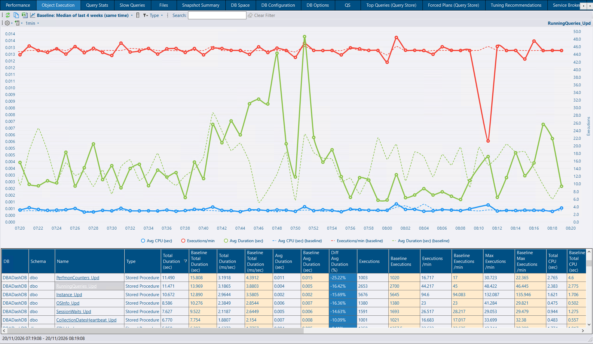
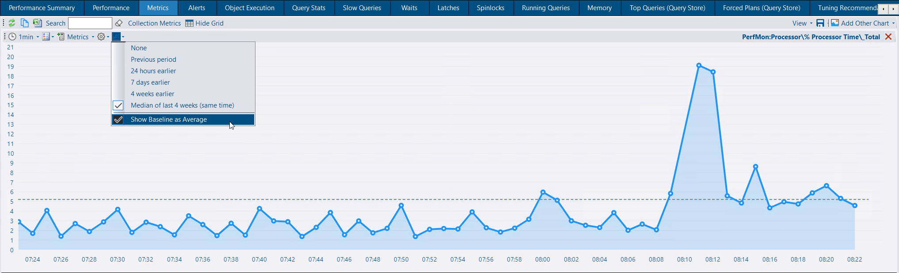
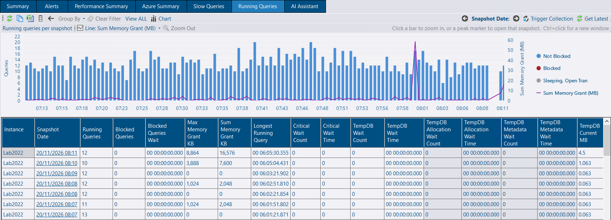
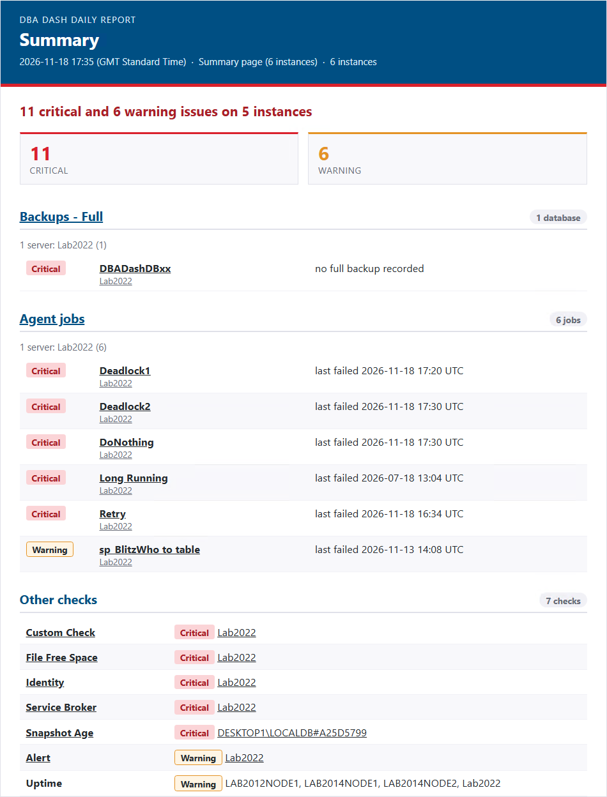
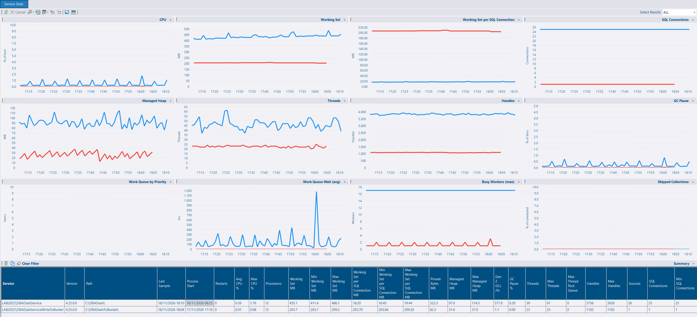

## Performance tab

### Insights and baselines

New insight cards show what's over a Performance Summary threshold, or above baseline for the time of day and day of week, in the tab's date range - plus what the charts don't show: DBA Dash alerts, performance counters outside their thresholds, a restart or offline period, AG role changes, configuration/trace flag/patch/schema changes, failed and long running jobs, tempdb contention, and gaps in collection or collection errors. Cards link to the relevant tab or zoom the date range to the hour that matters, and start loading alongside the refresh without holding up the charts.

Baseline is the median of the same hours 1 to 4 weeks earlier. The CPU, Waits and instance-level IO charts get a dashed **Baseline** line (new toolbar icon, remembered per chart or toggled for all), and latency figures now show throughput alongside it, for example *"at 1,200 IOPs, 45 MB/s (baseline 800 IOPs, 12 MB/s)"*. At least 2 weeks of history are needed before anything is said to be above baseline.

The Insights toolbar button (lightbulb, as on Running Queries) shows the count of cards by severity and can hide or show them.

### Lock waits on the blocking chart

**View > Lock Waits** (on by default) shades `LCK_*` wait time behind the blocking and deadlock markers on the blocking chart, with its own baseline line for the same hours in previous weeks. This makes short, frequent blocking more visible, even when it's only captured occasionally in the running query snapshots. Wait stats are instance wide, so at database level the series is labelled **(Instance)**. See [Performance tab](/docs/help/deadlocks/#performance-tab).

### Query stats on execution stats

The execution stats chart has a new **Objects/Queries** toggle. **Queries** shows the top statements over time from the Query Stats tab's data. Note: query stats are collected every 5 minutes by default, so there will be fewer bars than for object execution stats, which are collected every minute by default.

## Baseline overlays on Object Execution and Metrics (4.26.1)

The **Object Execution** chart and each **Metrics** chart can now draw a baseline on the same chart, as dashed lines in each series' colour, shifted to line up with the period viewed. The **Baseline** menu chooses which baseline to use: the previous period, 24 hours, 7 days or 4 weeks earlier, or the median of the same time in the last 4 weeks. **Show Baseline as Average** draws each series' average over the baseline period as a flat dashed line instead. This replaces the separate comparison chart, whose scales didn't match.

## Running queries chart (4.26.1)

An instance's Running Queries summary view now has a stacked bar chart above the list of snapshots: not blocked, blocked (red) and sleeping with an open transaction (grey). When the range has more snapshots than fit, they're grouped into time buckets - each bar is the average over its snapshots, with a diamond marking the busiest snapshot so short spikes aren't averaged away.

Click a bucket to zoom the chart and the snapshot list into it, down to one bar per snapshot. Click a snapshot's bar or a peak marker to load that snapshot (Ctrl+click opens it in a new window). **Zoom Out** or **Back** returns to the previous range. An optional line on a second axis shows sum or max memory grant, tempdb/blocked/critical wait time, longest running query, oldest transaction or tempdb current MB, using the max per bar. See [Running Queries](/docs/help/running-queries/#running-queries-chart).

## Daily health report email

DBA Dash can now email a daily health summary of your instances, on a schedule you choose. Manage reports from **Alerts > Daily Reports**, scoped to all instances or chosen tags.

* **Full report** or **changes only** - what's new, worse, better or resolved since the last send. Nothing is sent when nothing has changed.
* **Checks and object issues**, marked new or ongoing, and **open alerts**.
* **Exception-based performance** from the last 24 hours, judged against your Performance Summary thresholds and, optionally, a baseline from previous weeks - with the top queries or lead blockers behind each finding.
* An optional **AI summary**, using names and figures only - never query text.

The Summary page also has a new **Report** toggle that shows the same layout in the app, with links to the matching tabs. See [Daily Reports](/docs/help/daily-reports/) for more information.

### Email servers

Email notification channels each carried their own SMTP settings, so every new channel repeated the host, port, credentials and from address. These now live in **Email Servers** (new toolbar icon on the Alerts page), which email channels and daily reports select - a channel or report only holds its recipients. The email channel has a server dropdown with **New server...** to create one, and a server can't be deleted while it's in use.

On upgrade, each existing email channel gets a server with its current settings. See [Email Servers](/docs/help/alerts/#email-servers).

## Service stats

The DBA Dash service now samples its own resource usage - CPU, memory, GC, threads, handles, collection work queue and source connection counts - and reports it to the repository, with no extra queries against your monitored instances. It's collected once **Log Internal Performance Counters** is turned on. A new **Service Stats** system report shows a summary row per service (current, min/max/avg and rates) and 12 over-time charts, scoped to the services that collect or import the instances in context. See [Log Internal Performance Counters](/docs/setup/options/#log-internal-performance-counters).

## DBA Dash Visualizer - improved JSON file support (4.26.1)

DBA Dash Visualizer opens JSON lines files (`.jsonl`, `.ndjson`) as a grid, with a column per property, and lays out Serilog compact (`.clef`) logs as a log: Timestamp, Level, Message, Exception, then properties. Records that can't be read (such as a half-written last line) don't stop the file opening, and a log that's still being written can be viewed.

DBA Dash Visualizer is a separate app, but DBA Dash itself has the same features, so you can use either to open JSON files as a grid with many options for filtering, grouping and export. The next version of DBA Dash will switch from text-based logs to JSON, and DBA Dash Visualizer is the perfect tool to view these log files.

See [DBA Dash Visualizer](/docs/help/dba-dash-visualizer/#json-lines-and-serilog-logs).

## Also in this release

* Chart context menus (Copy Image, Save Image, etc.) get a **Legend** submenu: **Show on This Chart**, and **Show on All Charts** for every chart in the same tab or report. Service Stats charts, one line per service, now start with their legend hidden.
* The Memory tab opens on the stacked column chart (Pages KB, Avg) instead of the pie chart. Switching to the pie chart now draws it from the clerks already loaded in the grid, instead of needing a fresh load.
* Folder, S3 and failed-message-folder destinations can write gzip-compressed `.xml.gz` files instead of `.xml`, off by default. The failed message folder is capped at 1000 files, so a repository that keeps rejecting imports no longer fills the disk. See [Destination Connection](/docs/setup/options/#destination-connection).
* The Community Tools manifest was updated to the latest upstream releases. See [Community Tools](/docs/help/community-tools/).
* CPU, Counter and Wait alert rules allow an evaluation period of up to a day (1440 minutes), up from 60, matching Failed Logins ([#2300](https://github.com/trimble-oss/dba-dash/issues/2300)).
* The IO chart's baseline is drawn in a lighter shade of the MB/sec line, instead of grey, so it's clear which line it belongs to.
* The query plan viewer shows **Estimated Rows Read** with the other row estimates, formatted like them, instead of as a raw value under "Other".
* Fixed: Performance tab charts could sometimes be left showing empty default axes after switching instance, until the window was resized.
* Fixed: report charts (CPU, Blocking, IO, Execution Stats) kept their old size after a maximize, restore or splitter drag.
* Fixed: Availability Groups failed on a group node with a single instance.
* Fixed: a PK_Summary violation when two summary refreshes ran together on a new repository.
* Fixed: switching connections refreshed the selected tab twice.
* Fixed: upgrading from the About dialog could prompt to stop the service config tool (4.26.1).
* Fixed: after opening the Performance tab, the window could throw `ObjectDisposedException` every time it was activated, from a removed insight card keeping focus ([#2315](https://github.com/trimble-oss/dba-dash/issues/2315), 4.26.1).

## Bug fixes & minor changes

See the release notes on GitHub for the full list:

- [4.26.1](https://github.com/trimble-oss/dba-dash/releases/tag/4.26.1)
- [4.26.0](https://github.com/trimble-oss/dba-dash/releases/tag/4.26.0)
