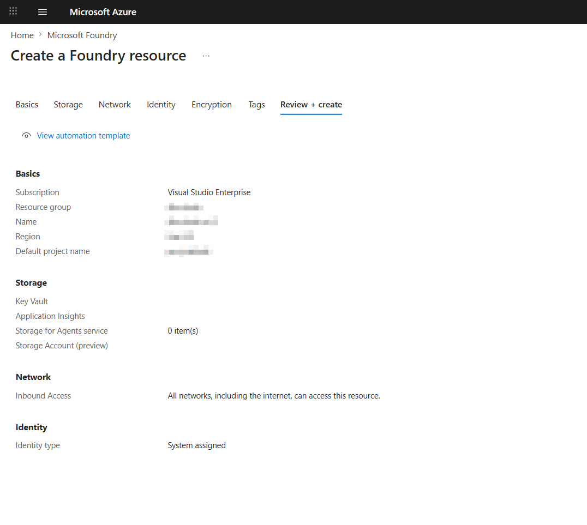
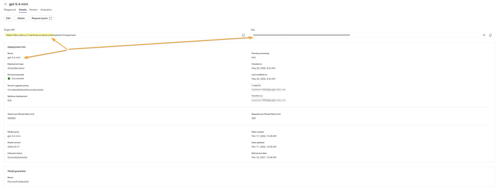
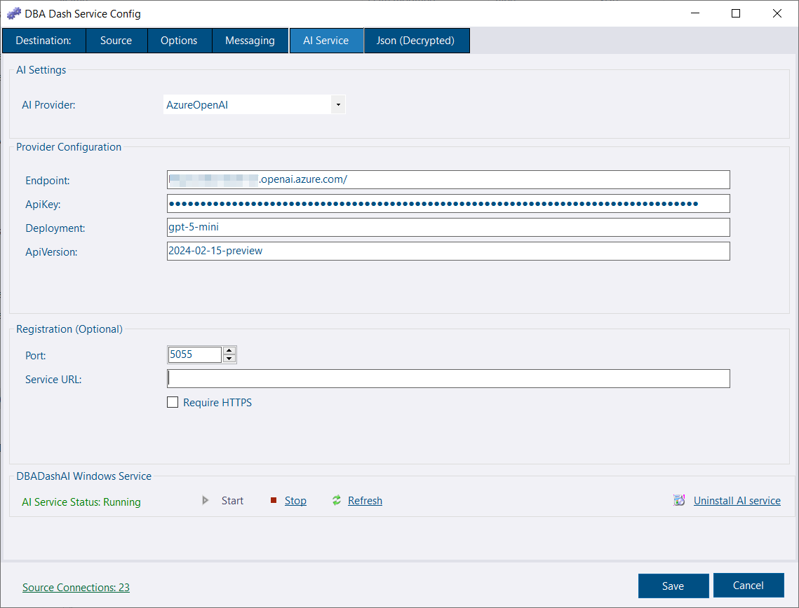

The AI Assistant analyses your DBA Dash repository data and answers natural-language questions about alerts, performance, waits, backups, blocking, slow queries, and more.

## How it works

Two components work together:

| Component | Role |
|---|---|
| **DBADashAI** (`DBADashAI.dll`) | ASP.NET Core web service. Runs SQL tools against the repository DB, optionally calls an LLM to summarise findings, and exposes `/api/ai/*` endpoints. |
| **DBADash GUI** | Discovers the AI service, calls the API, and renders the response in the AI Assistant tab. |

---
## Prerequisites

* [.NET 10.0.9](https://dotnet.microsoft.com/en-us/download/dotnet/10.0) or later is recommended. ASP.NET Core Runtime & .NET Desktop Runtime.

Use `dotnet --list-runtimes` to check installed versions.

---

## Quick Start (Azure Foundry)

* Open the Azure portal
* Create a Foundry resource
[](create-foundry.png)
* Open the new Foundry resource and go to the Foundry portal
* Go to Build
* Deploy a base model. Select a model and deploy, e.g., `gpt-5.4-mini`.
* Click the model in the grid.
* Click the details tab
[](azure-portal.png)

---

[](ai-assistant-configuration.png)

* Go to the AI Service tab in the DBA Dash service config tool
* Set the provider to AzureOpenAI
* Set the endpoint to the Target URI from the portal, omitting `/openai/v1/responses`, e.g., `https://****.services.ai.azure.com`
* Copy the ApiKey from the portal
* Set deployment to the deployment name, e.g., `gpt-5.4-mini`
* Set ApiVersion to `2024-12-01-preview`
* The registration service URL can be left blank to run in local mode. Or configure a URL to be used, allowing GUI clients running on other machines to discover the AI service.
* Click the link to install as a service.

The service will read the repository connection string from `ServiceConfig.json`. If the config file is encrypted, use the same account as the DBA Dash service to allow decryption, or see [Repository connection string](#repository-connection-string).

The service config tool creates/modifies the `appsettings.local.json` file which will override default settings from the `appsettings.json` file (overwritten on upgrade).

## Deployment modes

### Local mode (default — recommended for getting started)

Run `DBADashAI` on the same machine as the GUI. It binds to `localhost` only and requires no authentication — the loopback interface is the security boundary.

- No certificates required
- No API key required
- Not registered in the repository database
- Only the GUI on that machine can use it

**`appsettings.local.json` — leave `Registration:ServiceUrl` empty:**

```json
{
  "Registration": {
    "ServiceUrl": "",
    "Port": 5055
  }
}
```

### Shared/repository mode

Deploy `DBADashAI` on a central server accessible to all GUI clients. Set `Registration:ServiceUrl` to the URL that clients will connect to. The service binds to all interfaces, registers that URL in the repository database, and enforces API key authentication.

Shared mode listens on HTTPS. On the **AI Service** tab, **Use HTTPS** is next to the port. **Certificate** can stay on **Automatic (self-signed)**, or you can pick a certificate from the Local Computer Personal store. The service creates the self-signed certificate, keeps it in `%ProgramData%\DBADash\AI`, and registers its thumbprint with the service URL. GUI clients accept that certificate, or a certificate Windows already trusts for the host. A store certificate should match the host in the service URL, and the AI service account needs permission to use its private key. The self-signed certificate lasts two years and is renewed in the last 30 days, or when its name no longer matches the service URL.

**`appsettings.local.json`:**

```json
{
  "Registration": {
    "ServiceUrl": "https://aiserver.corp.com:5055",
    "Port": 5055
  }
}
```

Leave `Security:CertificateThumbprint` empty for the self-signed certificate. Set it to a thumbprint from the Local Computer Personal store to use that certificate instead. `Security:EnableHttps` defaults to on for a shared service. Set it to `false` when a reverse proxy terminates TLS and the service should keep listening on HTTP. An `https://` service URL on a port other than `Registration:Port`, with `EnableHttps` left unset, is treated as that existing proxy setup.

An existing Kestrel endpoint, listen URL, or `Kestrel:Certificates:Default` is left in place. When the certificate thumbprint can be read, it is registered so GUI clients can accept a certificate Windows does not trust.

GUI clients discover the URL, the API key and the certificate thumbprint from the repository database. Each client keeps the thumbprint for that service's host and port. No client-side certificate installation is required.

---

## Configuration reference (`appsettings.local.json`)

All AI service configuration lives in `appsettings.local.json` in the `DBADashAI` folder. `ServiceConfig.json` is not used by the AI service except to inherit the repository connection string when they are co-located.

### Repository connection string

Required. Tells the AI service which DBA Dash database to query.

```json
{
  "ConnectionStrings": {
    "Repository": "Server=sql-server;Database=DBADashDB;Integrated Security=true;Encrypt=true;"
  }
}
```

If `DBADashAI` is deployed in the same folder as the collection service, this is inherited automatically from `ServiceConfig.json` and does not need to be set here.

### AI provider

At least one provider must be configured for the LLM summary to work. Without a provider the service still runs — tool data is returned but the `summary` field will be empty.

#### Azure OpenAI

```json
{
  "AI": { "Provider": "AzureOpenAI" },
  "AzureOpenAI": {
    "Endpoint": "https://<resource>.openai.azure.com",
    "ApiKey": "<key>",
    "Deployment": "<deployment-name>",
    "ApiVersion": "2024-12-01-preview"
  }
}
```

#### Anthropic (direct or via Azure Foundry)

```json
{
  "AI": { "Provider": "Anthropic" },
  "Anthropic": {
    "BaseUrl": "https://api.anthropic.com",
    "ApiKey": "<key>",
    "Model": "claude-3-5-sonnet-20241022",
    "Version": "2023-06-01",
    "MaxTokens": 1024
  }
}
```

For Anthropic via **Azure Foundry**, set `BaseUrl` to the base Foundry URL (ending in `/anthropic/`):

```json
{
  "Anthropic": {
    "BaseUrl": "https://<resource>.services.ai.azure.com/anthropic/",
    "ApiKey": "<foundry-api-key>",
    "Model": "<deployment-name>"
  }
}
```

#### Amazon Bedrock

```json
{
  "AI": { "Provider": "Bedrock" },
  "Bedrock": {
    "Region": "us-east-1",
    "Model": "us.anthropic.claude-sonnet-4-6",
    "Profile": "",
    "ApiKey": "",
    "MaxTokens": ""
  }
}
```

Bedrock is only used when `AI:Provider` is `Bedrock`. The service calls the [Converse API](https://docs.aws.amazon.com/bedrock/latest/userguide/conversation-inference.html), so any chat model on Bedrock works (Anthropic Claude, Amazon Nova, Meta Llama, Mistral, and others).

Bedrock can be called with AWS credentials or with a Bedrock API key:

* **AWS credentials (recommended).** Leave `ApiKey` blank. The service takes credentials from `Profile` if it is set, or otherwise from the default AWS credential chain: an IAM role (EC2 instance profile, ECS task role, EKS web identity), the `AWS_*` environment variables, or the default profile of the account the service runs as. For each call it makes a short-term Bedrock API key from those credentials, valid for at most 12 hours or until the credentials expire. On premises, IAM Roles Anywhere through a profile's `credential_process` gives short-term credentials without a stored secret.
* **API key.** Set `ApiKey` to an [Amazon Bedrock API key](https://docs.aws.amazon.com/bedrock/latest/userguide/api-keys.html). It takes priority over AWS credentials. AWS recommends API keys for exploration only, and short-term keys from the console expire within 12 hours, so a service needs a long-term key.

The other settings:

| Key | Description |
|---|---|
| `Region` | AWS region name, such as `eu-west-2`. Checked before it is used in the host name. |
| `Model` | A model ID or inference profile ID. Most current models can only be called through an inference profile, the ID with a geographic prefix such as `us.` or `eu.`. Calling the base model ID returns a validation error. An application inference profile is given by its ARN. Use the bedrock-runtime model ID from the model card, not the bedrock-mantle one (`openai.gpt-oss-120b-1:0`, not `openai.gpt-oss-120b`). An inference profile ID only works in a region whose profile list includes it. |
| `Profile` | Optional named AWS profile. Leave blank to use the default credential chain. |
| `MaxTokens` | Optional cap on the answer length. Leave blank for the model's default. |
| `Url` | Optional. The full Converse URL of a gateway or proxy in front of Bedrock. `{model}` in the URL is replaced with the model ID (URL-encoded, so an ARN stays one path segment). Must be an absolute `http` or `https` URL. |

When `Url` is set and `ApiKey` is set, `Region` can be left blank. The service calls that URL and skips the model list, so the GUI model picker is hidden and the configured `Model` is used. Without an API key, `Region` is still required: the short-term key made from AWS credentials is signed with it, including when the call is sent to a gateway.

The GUI's model picker lists the inference profiles and on-demand text models available in the region, with the ID to configure in brackets. Listing models needs `bedrock:ListInferenceProfiles` and `bedrock:ListFoundationModels`. Without those permissions the picker is hidden and the configured `Model` is used.

To find model IDs outside the GUI, use the model card in the Bedrock console (the bedrock-runtime row of the Programmatic Access table) or the AWS CLI:

```bash
aws bedrock list-inference-profiles --region eu-west-2 --query "inferenceProfileSummaries[].inferenceProfileId"
```

```bash
aws bedrock list-foundation-models --region eu-west-2 --by-output-modality TEXT --by-inference-type ON_DEMAND --query "modelSummaries[].modelId"
```

**AWS credentials and the Windows service.** The default credential chain is that of the account the service runs as. On EC2 the instance role just works. Elsewhere, either run the service as an account whose `%USERPROFILE%\.aws` holds the profile, or set the `AWS_SHARED_CREDENTIALS_FILE` and `AWS_CONFIG_FILE` environment variables for the service and name the profile in `Profile`. IAM Identity Center (SSO) profiles are not supported. They need an interactive sign-in.

**IAM permissions.** For AWS credentials (an instance profile, task role or profile), grant the role:

```json
{
  "Version": "2012-10-17",
  "Statement": [
    {
      "Sid": "UseShortTermBedrockKeys",
      "Effect": "Allow",
      "Action": "bedrock:CallWithBearerToken",
      "Resource": "*",
      "Condition": { "StringEquals": { "bedrock:bearerTokenType": "SHORT_TERM" } }
    },
    {
      "Sid": "InvokeModels",
      "Effect": "Allow",
      "Action": "bedrock:InvokeModel",
      "Resource": [
        "arn:aws:bedrock:*::foundation-model/*",
        "arn:aws:bedrock:*:<account-id>:inference-profile/*",
        "arn:aws:bedrock:*:<account-id>:application-inference-profile/*"
      ]
    },
    {
      "Sid": "ListModelsForThePicker",
      "Effect": "Allow",
      "Action": [ "bedrock:ListFoundationModels", "bedrock:ListInferenceProfiles" ],
      "Resource": "*"
    }
  ]
}
```

* `bedrock:CallWithBearerToken` lets the role use the short-term key the service makes from its credentials. Without it every call is refused, even with `InvokeModel` allowed. Check that no service control policy denies it.
* `bedrock:InvokeModel` is all the Converse API needs. The service does not stream. The foundation-model ARN has a region wildcard because a geo or global inference profile routes to other regions, and the permission is needed in each of them.
* The List actions only fill the GUI's Model picker.
* To allow specific models only, list each inference profile ARN together with its foundation-model ARN in every region the profile covers. See [Prerequisites for inference profiles](https://docs.aws.amazon.com/bedrock/latest/userguide/cross-region-inference-prereq.html). The `AmazonBedrockLimitedAccess` managed policy also works, but grants far more than the service needs.
* Model access is separate from IAM. Some models need a one-off step in the Bedrock console (a use-case form for Anthropic, a subscription for Marketplace models). Do that as an admin rather than giving the role Marketplace permissions.

With an API key instead, the IAM user the key belongs to needs the same `InvokeModel` and List permissions, and `bedrock:CallWithBearerToken` for `LONG_TERM` keys.

#### Ollama (local models)

Runs against a local or self-hosted [Ollama](https://ollama.com/) server instead of a hosted LLM. Like Bedrock, Ollama is never auto-selected. Set `AI:Provider` to `Ollama`.

```json
{
  "AI": { "Provider": "Ollama" },
  "Ollama": {
    "BaseUrl": "http://localhost:11434",
    "ApiKey": "",
    "Model": "<model-name>",
    "ContextLength": 32768,
    "MaxTokens": "",
    "TimeoutSeconds": 240
  }
}
```

| Key | Description |
|---|---|
| `BaseUrl` | URL of the Ollama server. |
| `ApiKey` | Optional - only needed if the server requires a bearer token (e.g. behind a reverse proxy). |
| `Model` | Default model to use, e.g. `llama3.1`. Must already be pulled on the server. |
| `ContextLength` | Context window to request, in tokens. |
| `MaxTokens` | Optional cap on response length. Leave blank to use Ollama's default. |
| `TimeoutSeconds` | How long the service waits for a response before reporting a timeout. The GUI's own wait is a fixed 300 seconds, so keep this lower so the service times out first and can report the reason. |

`GET /api/ai/models` lists the models the provider can use: for Bedrock, the models available in the region; for Ollama, the models pulled on the server. They populate the Model menu in the [plan](/docs/help/query-plan-viewer/#ai-analysis) and [deadlock](/docs/help/deadlocks/#ai-analysis) viewers.

If `AI:Provider` is not set, the service auto-selects the first fully-configured provider in the order: AzureOpenAI → Anthropic. Bedrock and Ollama are only used when `AI:Provider` is set to `Bedrock` or `Ollama`.

### Registration

```json
{
  "Registration": {
    "ServiceUrl": "",
    "Port": 5055
  }
}
```

| Key | Description |
|---|---|
| `ServiceUrl` | The URL registered in the repository DB for GUI discovery. Empty = local mode (loopback binding, no auth, no DB registration). |
| `Port` | Port to listen on. Used in both modes. |

### Security

Only applies in shared/repository mode (`ServiceUrl` set). In local mode, auth is automatically disabled.

```json
{
  "Security": {
    "EnableHttps": true,
    "CertificateThumbprint": "",
    "KeyRotationDays": 30,
    "KeyGracePeriodHours": 24
  }
}
```

| Key | Description |
|---|---|
| `EnableHttps` | Shared mode listens on HTTPS when this is true or unset, unless an `https://` service URL uses a different port from the listener (an existing reverse proxy). Set `false` to listen on HTTP. Local mode ignores this and stays on HTTP. |
| `CertificateThumbprint` | Thumbprint of a certificate in the Local Computer Personal store. Empty creates a self-signed certificate and registers its thumbprint. A thumbprint that cannot be loaded stops the service. |
| `KeyRotationDays` | Automatically rotates the shared API key after the specified number of days. Set `0` or less to disable rotation. |
| `KeyGracePeriodHours` | Grace period for previous keys during rotation. |

Authentication is always on in shared mode. The health endpoint (`/api/ai/health`) stays unauthenticated for load-balancer probes.

With **Use HTTPS** turned off and no reverse proxy, the API key is sent without encryption.

### Logging

```json
{
  "Logging": {
    "LogLevel": {
      "Default": "Information",
      "Microsoft.AspNetCore": "Warning",
      "DBADashAI": "Information"
    }
  }
}
```

### Azure Key Vault (optional)

Store secrets in Key Vault instead of `appsettings.local.json`. Use `--` to represent hierarchy in secret names (e.g., `AzureOpenAI--ApiKey`).

```json
{
  "KeyVault": {
    "VaultUri": "https://<vault>.vault.azure.net/",
    "ManagedIdentityClientId": ""
  }
}
```

---

## Installing as a Windows service

Use the **AI Service** tab in the DBADashServiceConfig tool, or run `sc.exe` manually:

```powershell
sc.exe create DBADashAI `
    binPath="\"C:\Program Files\dotnet\dotnet.exe\" \"C:\DBADash\DBADashAI\DBADashAI.dll\"" `
    start= auto
sc.exe start DBADashAI
```

Configure the service by editing `appsettings.local.json` in the `DBADashAI` folder before or after installation. Restart the service to apply changes.

---

## GUI discovery

The GUI uses the following priority order to locate the AI service:

1. **Local probe** — always checks `http://localhost:5055` first. If reachable, uses it with no authentication. The health endpoint returns a repository fingerprint. If the local service is pointed at a different database than the GUI is connected to, a warning is shown and the tab is disabled, unless the repository registers a different service, which is then used instead.
2. **Repository database** — if no local service responds, reads `AI.ServiceConfig` for the shared service URL and API key registered by the central deployment.

If neither source is available the AI Assistant tab is hidden.

> **Role requirement** — Even when a service is reachable, the AI Assistant tab is only shown to users who are admins (**db_owner** or **sysadmin** on the repository database) or members of the **AIUser** role. If you can reach the service but the tab is still missing, verify that your repository login has one of these roles assigned.

---

## Deadlock and query plan analysis

The AI service is also used by the **AI Analysis** tab in the [deadlock viewer](/docs/help/deadlocks/#ai-analysis) and the [query plan viewer](/docs/help/query-plan-viewer/#ai-analysis). Nothing is sent until you press **Submit for analysis**, and the exact request is shown first so you can review it.

**Submit** and follow-up questions are available when the signed-in user can use the AI service key. That is the **AIUser** role, or db_owner, for a service whose key is stored in the repository. A local service that does not require a key can be used by anyone who can see the tab. A user without access to the key can still preview the request and copy the prompt. The status line says when submit is unavailable.

### AI conversations

Both viewers support follow-up questions. Where each part of the conversation is stored depends on who it belongs to:

| Part | Stored | Visible to |
|---|---|---|
| **Initial analysis** | Repository database | Other DBA Dash users - so the same deadlock or query doesn't need to be analysed twice |
| **Follow-up questions and answers** | Locally, in `%LOCALAPPDATA%\DBADash\AiConversations`, protected with Windows DPAPI | You only |

Keeping follow-ups local means no one else can read them - including administrators of the repository database - without access to your Windows profile. The trade-off is that they don't roam between machines, and are lost if the machine is rebuilt.

Select **Options > My AI conversations...** on the **AI Analysis** tab to **Export** or **Import** your conversations. An export is plain JSON unless you provide a passphrase to protect it. Importing merges with the conversations already on the machine.

---

## API endpoints

| Endpoint | Auth | Description |
|---|---|---|
| `GET /api/ai/health` | None | Service health + repository fingerprint |
| `GET /api/ai/diagnostics` | Required | Configuration summary (keys redacted; for Bedrock, whether an API key or AWS credentials are used) |
| `GET /api/ai/tools` | Required | Available tools and metadata |
| `GET /api/ai/examples` | Required | Example questions grouped by category |
| `GET /api/ai/models` | Required | Available LLM models (for Bedrock, the models available in the region; for Ollama, the models installed on the server) |
| `POST /api/ai/ask` | Required | Ask a question |
| `POST /api/ai/proactive-digest` | Required | Proactive risk digest |
| `POST /api/ai/feedback` | Required | Submit helpful/not-helpful feedback |
| `GET /api/ai/feedback` | Required | Recent feedback |
| `GET /api/ai/test-anthropic` | Required | Test Anthropic provider connectivity and configuration |

---

## Troubleshooting

### Log files

The AI service writes detailed logs to `DBADashAI-log-YYYYMMDD.txt` files in the `Logs` folder located in the same directory as the service. Check these files first when diagnosing any issue — they capture startup errors, provider configuration problems, and request-level details that are not surfaced in the GUI.

### AI Assistant tab is not shown

- In local mode: verify the service is running — `Invoke-RestMethod http://localhost:5055/api/ai/health`
- In shared mode: check `AI.ServiceConfig` exists and `IsActive = 1` (heartbeat within 2 minutes)
- Verify that your repository login is **db_owner** or **sysadmin** on the repository database, or a member of the **AIUser** role — the tab is hidden for users who have neither

### "AI service is connected to a different repository"

The local service's `ConnectionStrings:Repository` points to a different database than the GUI is connected to. Either update the AI service connection string or switch the GUI to the matching repository.

### Summary is empty

The LLM provider is not configured or unreachable. Check `AI:Provider` and the corresponding provider section. Use `GET /api/ai/diagnostics` (authenticated) to inspect the resolved configuration.

### Bedrock errors

| Message | Cause |
|---|---|
| `The provided model identifier is invalid` (400) | The model ID isn't one bedrock-runtime knows in this region. Common causes: a bedrock-mantle ID (no version suffix, for example `openai.gpt-oss-120b` instead of `openai.gpt-oss-120b-1:0`), or an inference profile prefix (`eu.`, `us.`, `global.`) that doesn't exist for the model. Pick the model from the GUI's Model picker to get an ID that works. |
| `Invocation of model ID ... with on-demand throughput isn't supported` (400) | The model can only be called through an inference profile. Use its `us.`, `eu.` or `global.` ID. |
| `You don't have access to the model` / 403 | The credentials or API key lack `bedrock:InvokeModel` for the model, or the model needs a marketplace subscription or use-case form in the Bedrock console. |
| `Bedrock:ApiKey is not set and no AWS credentials were found` | No API key is set, and the service account has no AWS credentials (or `Profile` names a profile it can't find). See [AWS credentials and the Windows service](#amazon-bedrock). |
| `Bedrock:Region must be an AWS region name` | `Region` is blank or mistyped. It must look like `eu-west-2`. |

The service log records Bedrock's full response for every failed call, with the ErrorId shown in the GUI.

### 401 Unauthorized

Shared mode only. The GUI retrieves the API key from the database automatically. If it fails, check that `AI.ServiceConfig` has a valid key and the GUI has read access to that table.

### Port conflict

Change the port on the **AI Service** tab of the service config tool (**Port**, under Registration), or set `Registration:Port` in `appsettings.local.json`, and restart the service. The GUI's local probe only checks `http://localhost:5055`, so a local-mode service on another port isn't found. To run on another port, for example a second AI service on the same machine, also set **Service URL** on the same tab (`Registration:ServiceUrl`, such as `http://localhost:5056`) so the GUI finds it through the repository. A service on the default port that belongs to a different repository is then ignored in favour of the registered one.

### AI Service won't start

* Check that you have the correct .NET Runtime installed.  See [Prerequisites](#prerequisites)
* Check [log files](#log-files)
* Check for errors in Windows Event Viewer
