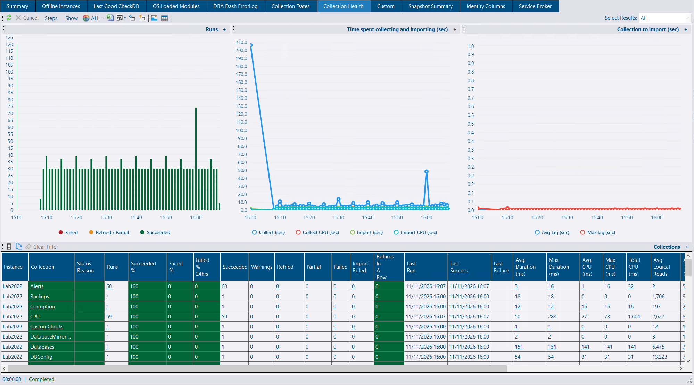
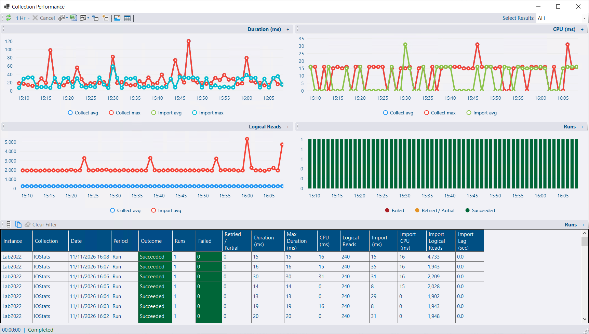
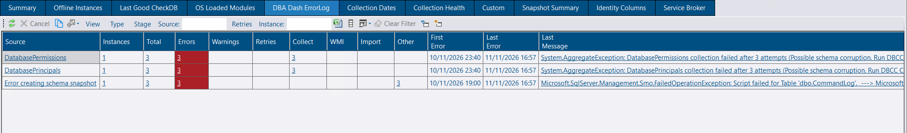


Collection Health is available from 4.25.0.


The DBA Dash service reports every collection run to the repository. Collection Health shows whether your collections are working, how much they cost, and how long their data waits before it's imported.

## Where to find it

* **Collection Health** tab under the **Checks** node of the tree.
* **Collection Health** column on the **Summary** tab. Click a cell to open the Collection Health tab for that instance.

## Collection Health and Collection Dates

DBA Dash checks collections in two ways, and both are shown on the **Summary** tab:

| Check | Summary column | Tab | What it catches |
|---|---|---|---|
| Collection Health | **Collection Health** | Collection Health | Collections that run but fail, partly fail or fail to import |
| Collection Dates | **Snapshot Age** | Collection Dates | Collections that haven't run within the expected time |

Collection Health can only report on runs that happen. If a collection stops running altogether - the service is stopped, an instance has been removed from the service config, or a schedule is broken - there are no failed runs to report. **Snapshot Age** catches this. It highlights a collection whose last run is older than its threshold.

On the **Collection Dates** tab under the **Checks** node, a collection with no threshold set uses one based on its schedule: warning at twice the longest interval between runs plus 3 minutes, and critical at 4 times the interval plus 6 minutes. You can set your own thresholds for all instances or for one instance. See [Collection Thresholds](/docs/help/schedule/#collection-thresholds).

Use both: Snapshot Age tells you a collection has stopped, and Collection Health tells you a collection is running but not working.

## Run outcomes

Each collection run is recorded with one of these outcomes:

| Outcome | Meaning |
|---|---|
| **Succeeded** | The collection ran without errors. |
| **Warning** | The collection succeeded, but logged a warning. |
| **Retried** | The collection succeeded after one or more attempts failed. |
| **Partial** | Part of the collection logged an error, but it still collected some data. For example, one WMI query out of several failed. |
| **Failed** | The collection logged an error and collected no data. |
| **Import Failed** | The data was collected, but a table failed to import into the repository. |

Some collections have steps that run after them, such as collecting query text and plans for running queries and query stats. These steps are recorded as runs of their own.

## The report

The report shows a row per collection per instance, or a row per collection across all the selected instances. It can include or leave out the steps that follow some collections. Columns include:

* Success rate, failures in a row, retries and partial runs
* Status, and the reason for it
* Collect and import duration
* CPU and logical reads, on the monitored instance and in the repository
* Import lag

Hover over a column heading to see which period it covers. Failures in a row show the current state, whatever period is selected. A weekly collection that failed at the weekend still shows as failing over the last hour.

Charts show runs by outcome, cost and import lag over time. Where each run is kept (see [Cost](#cost)), the charts go down to 5 minute buckets.

The counts link to the errors behind them. **Errors**, **Failed** and **Import Failed** leave out retries, and **Retried** includes them. **Last Failure** links to the errors for that failure, whatever period is selected.

### Collection Performance

Click a collection to open a **Collection Performance** report, which shows each run (or each hour) for that collection over time.

## Status and thresholds

A collection's status is **OK**, **Warning** or **Critical**. Two things can raise it.

### Failures in a row

Failures in a row only raise a status when they reach both a number of failed runs and a time since the last success:

| Status | Failed runs | Time since last success |
|---|---|---|
| Warning | 1 | 10 minutes |
| Critical | 3 | 30 minutes |

A collection that runs every minute has to keep failing for 10 minutes before it shows. A collection that runs daily shows on its first failure. If a collection has never succeeded, only the number of failed runs is used.

### Failure rate

The failure rate is used when there are at least 5 runs:

| Status | Failure rate |
|---|---|
| Warning | 10% of runs failed or partly failed |
| Critical | 50% of runs failed, and the latest run failed |

A collection that has recovered is a warning at most. On the Summary tab, the failure rate covers the time since errors were last acknowledged, up to 24 hours.

### Changing the thresholds

Click the **Thresholds** column to change the thresholds. They can be set for:

* a collection on one instance
* every collection on an instance
* a collection on every instance
* every collection on every instance

The most specific setting wins, one threshold at a time. Anything not set uses the defaults above. Select **Don't monitor** to stop a collection affecting the status.

Paused instances and disabled schedules show as **N/A**.

### Acknowledging errors

**Acknowledge Errors** on the DBA Dash ErrorLog toolbar clears failures in a row until the next failure.

### Older services

Instances whose DBA Dash service is older than 4.25 don't report collection runs. For those, the Summary tab counts collection and import errors in the last 24 hours, as before.

## Cost

Turn on **Log Internal Performance Counters** in the service config tool to record cost. With it on:

* Each run is kept, as well as the hourly rollup.
* CPU and logical reads are recorded for each collection on the monitored instance.
* CPU, logical reads and duration are recorded for importing each collection into the repository.

Without it, only the hourly rollup is kept, CPU and logical reads aren't recorded, and the charts use hourly averages.



On the monitored instance, DBA Dash reads its own connection's `cpu_time` and `logical_reads` from `sys.dm_exec_sessions` when a collection finishes. A connection starts with these counters at zero, including a pooled connection, which is reset when it's reused, so they show what the collection used. A connection can always see its own session, so no extra permissions are needed. It costs one small query per connection, and it only runs with **Log Internal Performance Counters** on.

Collections that don't use a SQL connection, such as WMI, report no CPU rather than zero.

In the repository, the importer measures each table it imports the same way and adds the cost to the collection run the table belongs to.



## Import lag

Import lag is the time from the service handing a batch of collected data to its destination to the import starting.

* When the service writes straight to the repository database, import lag is near zero.
* When the destination is an [S3 bucket or a folder](/docs/setup/options/#secondary-destinations), import lag is the backlog waiting to be imported.

## Metrics and alerts

Collection Health data is also available as DBA Dash counters:

| Counter | Description |
|---|---|
| Collection Duration (ms) | Time to run the collection |
| Collection CPU (ms) | CPU used on the monitored instance |
| Collection Logical Reads | Logical reads on the monitored instance |
| Collection Failed | 1 for a failed run, 0 otherwise. Its average is the failure rate |
| Collection Import Duration (ms) | Time to import into the repository |
| Collection Import CPU (ms) | CPU used in the repository |
| Collection Import Logical Reads | Logical reads in the repository |
| Collection Import Lag (ms) | See [Import lag](#import-lag) |

These can be charted and used in [alert rules](/docs/help/alerts/) like any other counter. On the **Metrics** tab they're hidden by default. Click **Collection Metrics** to show them. **Collection Duration (ms)** keeps the same CounterID it had before 4.25, so existing alert rules on it carry on working.

## DBA Dash ErrorLog

The **DBA Dash ErrorLog** tab under the **Checks** node lists the errors behind Collection Health. It opens on a row per instance, or a row per source when one instance is selected. The counts are split two ways:

* **Errors / Warnings / Retries** - what kind of error
* **Collect / WMI / Import / Other** - where it happened

Click an instance, a source or a count to narrow the report, and **Back** to go up again.

### WMI suggestions

When 2 or more collections on an instance fail with WMI errors, WMI is probably not working on that instance at all. Collection Health and the ErrorLog show a card suggesting that you fix WMI access, or select **No WMI** for the instance on the Source tab of the service config tool. See [WMI](/docs/help/wmi/).

## Data retention

| Table | Contents | Default retention |
|---|---|---|
| `dbo.CollectionRuns` | Each run (only with Log Internal Performance Counters on) | 30 days |
| `dbo.CollectionRuns_60MIN` | Hourly rollup | 365 days |

See [Data retention](/docs/help/data-retention/) to change these.
