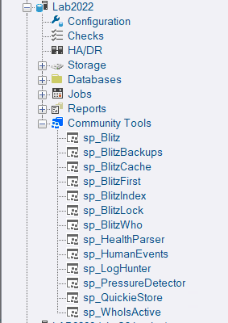
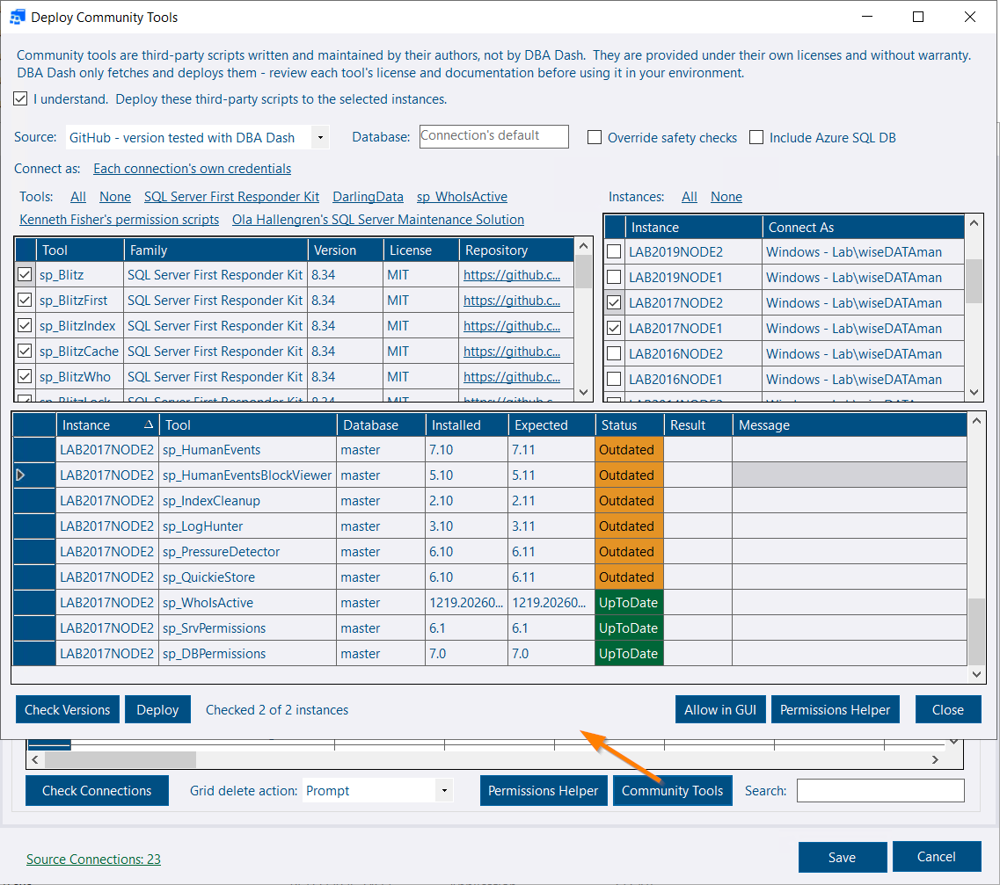
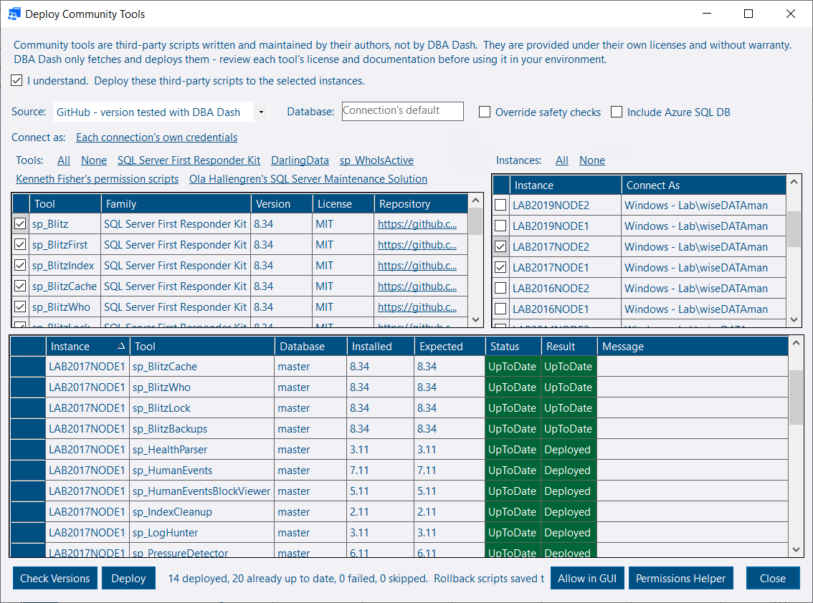
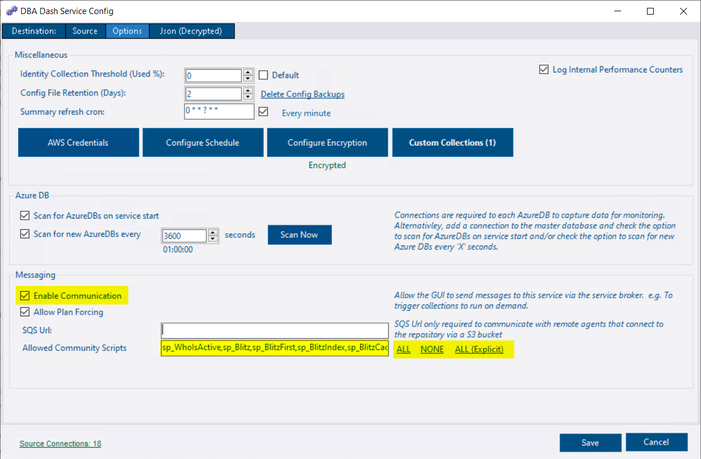

DBA Dash now supports various community scripts, including [Adam Machanic's](https://dataeducation.com/about/) [sp_WhoIsActive](https://whoisactive.com/), [Brent Ozar's](https://www.brentozar.com/) [First Responder Kit](https://github.com/BrentOzarULTD/SQL-Server-First-Responder-Kit) and [scripts from](https://github.com/erikdarlingdata/DarlingData) [Erik Darling](https://erikdarling.com/).  This extends the functionality of DBA Dash which is itself a community tool.🤝

[](community-tools-tree.png)

Community Tools are executed on your monitored instances using the [Messaging](/docs/help/messaging) feature.  The GUI communicates with the service via the repository database using service broker.  The service runs the scripts and sends the data back to the GUI.  The complexity is hidden behind the scenes - once the scripts are deployed and security configured, it just works.

### Deploying from DBA Dash

From 4.24.0, DBA Dash can deploy and update these tools. Each build pins a release. The scripts are downloaded when you deploy them. They are not included in the installer.

A pinned release is tested by deploying it and reading the version from the procedure definition. The procedure is not executed, so the test does not cover what the tool does when you run it. Before a pin moves to a newer upstream release, that same deploy and version check is run on SQL Server 2022, and parameter changes are reported. **Latest** skips the hash check and that deploy check.


Community tools are third-party scripts, under their own licenses. DBA Dash fetches and deploys them. Review each tool before using it.


| Family | Tools |
|---|---|
| [First Responder Kit](https://github.com/BrentOzarULTD/SQL-Server-First-Responder-Kit) | sp_Blitz, sp_BlitzFirst, sp_BlitzIndex, sp_BlitzCache, sp_BlitzWho, sp_BlitzLock, sp_BlitzBackups, sp_ineachdb |
| [DarlingData](https://github.com/erikdarlingdata/DarlingData) | sp_HealthParser, sp_HumanEvents, sp_HumanEventsBlockViewer, sp_IndexCleanup, sp_LogHunter, sp_PressureDetector, sp_QuickieStore |
| [sp_WhoIsActive](https://whoisactive.com/) | sp_WhoIsActive |
| [Kenneth Fisher's permission scripts](https://github.com/sqlstudent144/SQL-Server-Scripts) | sp_SrvPermissions, sp_DBPermissions |
| [Ola Hallengren's Maintenance Solution](https://ola.hallengren.com/) | CommandExecute, DatabaseBackup, DatabaseIntegrityCheck, IndexOptimize |

`DBADashConfig -a ListCommunityTools` lists the pinned version of each tool.

In the service config tool, click **Community Tools** (beside Permissions Helper) or **Deploy Tools...** (beside Allowed Scripts).

[](community-tools-check.png)

1. Pick the tools and instances. Tools already in Allowed Scripts start ticked. Ticking a tool also ticks the tools it needs - `sp_Blitz` calls `sp_ineachdb`, so it is deployed with it, including on Azure SQL Database. Azure SQL Database is skipped unless **Include Azure SQL DB** is ticked.
2. **Check Versions** shows what is installed and whether it matches the pin.
3. Choose the source and database if you do not want the defaults.
4. **Connect as** uses each connection's own credentials. Use it to enter one login for every selected instance.
5. Tick the acknowledgement and click **Deploy**.

[](community-tools-deploy.png)

Deployment connects as you, not as the service account. After a deploy you can add the tools to Allowed Scripts and open the Permissions Helper to grant EXECUTE. Save the service configuration to apply Allowed Scripts. The Permissions Helper also grants EXECUTE on the other First Responder Kit procedures installed beside `sp_Blitz`, because `sp_Blitz` runs them to check their versions.

**Source** is **Pinned** (download the pinned release and check its SHA-256), **Latest** (the newest GitHub release, with no hash check and no deploy check), or **Folder** (scripts you have downloaded).

Checking and deploying follow SQL Server's lookup for an `sp_` procedure: the database the connection lands in, then master. An update changes the copy that will run. A tool that is not installed goes in the connection's database. `--Database` checks or deploys one database instead. On Azure SQL Database there is no lookup in master.

#### Maintenance Solution

DBA Dash does not run these procedures. No Agent jobs are created. They are not selected by default and are not added to Allowed Scripts. They go in the connection's database, or the database you name. They need SQL Server 2017 or later and are skipped on Azure SQL Database.

An existing procedure is replaced only when its definition is Ola Hallengren's. Anything else is **Conflict** and is left alone. A definition that does not match a known upstream release is **Modified** and is not updated. When parameters change, Agent job steps that call the procedure are checked first. The procedures in a database are updated together. A rollback script is written under `CommunityToolsRollback` before anything is replaced. **Override safety checks** (`--OverrideSafetyChecks`) replaces a Modified procedure or one whose update would break a job. An object that is not Ola's is never replaced.

#### Command line

```cmd
DBADashConfig -a CheckCommunityTools --ConnectionIDs *
DBADashConfig -a DeployCommunityTools --Tools "sp_WhoIsActive,FirstResponderKit" --ConnectionIDs "SQL1,SQL2" --AcceptDisclaimer
```

`--AcceptDisclaimer` is required to deploy. `--AddToAllowedScripts` adds the deployed tools to Allowed Scripts. `--SqlUser` connects with a SQL login. The password is prompted for, or read from `DBADASH_PASSWORD`. The command exits with code 1 if any deployment fails.

### Community Tools Setup

You can still deploy the tools yourself, and grant the service account EXECUTE, with [dbatools](https://dbatools.io/).

```pwsh
############# Setup ##############

## Instances to Deploy to
$SQLInstances = "SQL1","SQL2"

# DBA Dash service account user ($ at end for managed service account)
$DBADashServiceAccount = "YourDomain\DBADash$"

###################################

$DBADashServiceAccount = $DBADashServiceAccount.Replace("]","]]")

# sp_WhoIsActive deploy
Install-DbaWhoIsActive -SqlInstance $SQLInstances -Database master

# sp_WhoIsActive permissions
$GrantSQL = "GRANT EXECUTE ON sp_WhoIsActive TO [" + $DBADashServiceAccount + "]"
Invoke-DbaQuery -SqlInstance $SQLInstances -Query $GrantSQL

# FRK Deploy
Install-DbaFirstResponderKit -SqlInstance $SQLInstances -Database master

# FRK Permissions
$GrantSQL = "GRANT EXECUTE ON sp_Blitz TO [" + $DBADashServiceAccount + "]
GRANT EXECUTE ON sp_BlitzBackups TO [" + $DBADashServiceAccount + "]
GRANT EXECUTE ON sp_BlitzCache TO [" + $DBADashServiceAccount + "]
GRANT EXECUTE ON sp_BlitzIndex TO [" + $DBADashServiceAccount + "]
GRANT EXECUTE ON sp_BlitzFirst TO [" + $DBADashServiceAccount + "]
GRANT EXECUTE ON sp_BlitzLock TO [" + $DBADashServiceAccount + "]
GRANT EXECUTE ON sp_BlitzWho TO [" + $DBADashServiceAccount + "]
/* Required for sp_Blitz */
GRANT EXECUTE ON sp_AllNightLog TO [" + $DBADashServiceAccount + "]
GRANT EXECUTE ON sp_AllNightLog_Setup TO [" + $DBADashServiceAccount + "]
GRANT EXECUTE ON sp_BlitzQueryStore TO [" + $DBADashServiceAccount + "]
GRANT EXECUTE ON sp_DatabaseRestore TO [" + $DBADashServiceAccount + "]
GRANT EXECUTE ON sp_ineachdb TO [" + $DBADashServiceAccount + "]"
Invoke-DbaQuery -SqlInstance $SQLInstances -Query $GrantSQL

# Grant permissions to sql_expression_dependencies in each database for sp_BlitzIndex
$GrantSQL = "GRANT SELECT ON sys.sql_expression_dependencies TO [" + $DBADashServiceAccount + "]"
Get-DbaDatabase $SQLInstances | Invoke-DbaQuery -Query $GrantSQL

# Erik Darling scripts Deploy
Install-DbaDarlingData -SqlInstance $SQLInstances -Database master

# Erik Darling scripts permissions
$GrantSQL = "GRANT EXECUTE ON sp_HumanEvents TO [" + $DBADashServiceAccount + "]
GRANT EXECUTE ON sp_PressureDetector TO [" + $DBADashServiceAccount + "]
GRANT EXECUTE ON sp_QuickieStore TO [" + $DBADashServiceAccount + "]"
Invoke-DbaQuery -SqlInstance $SQLInstances -Query $GrantSQL

# sp_HealthParser (Erik Darling) deploy (Not included in Install-DbaDarlingData)
$HealthParser = (Invoke-WebRequest -Uri "https://raw.githubusercontent.com/erikdarlingdata/DarlingData/refs/heads/main/sp_HealthParser/sp_HealthParser.sql").Content
Invoke-DbaQuery -SqlInstance $SQLInstances -Query $HealthParser

# sp_HealthParser permissions
$GrantSQL = "GRANT EXECUTE ON sp_HealthParser TO [" + $DBADashServiceAccount + "]"
Invoke-DbaQuery -SqlInstance $SQLInstances -Query $GrantSQL

# sp_LogHunter (Erik Darling) deploy (Not included in Install-DbaDarlingData)
$LogHunter = (Invoke-WebRequest -Uri "https://raw.githubusercontent.com/erikdarlingdata/DarlingData/refs/heads/main/sp_LogHunter/sp_LogHunter.sql").Content
Invoke-DbaQuery -SqlInstance $SQLInstances -Query $LogHunter

# sp_LogHunter permissions.  Commented out as it requires sysadmin.
# Add-DbaServerRoleMember -SqlInstance $SQLInstances -ServerRole sysadmin -Login $DBADashServiceAccount

## Kenneth Fisher's permission tools

$sp_SrvPermissions = (Invoke-WebRequest -Uri "https://raw.githubusercontent.com/sqlstudent144/SQL-Server-Scripts/refs/heads/main/sp_SrvPermissions.sql").Content
Invoke-DbaQuery -SqlInstance $SQLInstances -Query $sp_SrvPermissions

$sp_DBPermissions = (Invoke-WebRequest -Uri "https://raw.githubusercontent.com/sqlstudent144/SQL-Server-Scripts/refs/heads/main/sp_DBPermissions.sql").Content
Invoke-DbaQuery -SqlInstance $SQLInstances -Query $sp_DBPermissions

$GrantSQL = "GRANT EXECUTE ON sp_SrvPermissions TO [" + $DBADashServiceAccount + "]
GRANT EXECUTE ON sp_DBPermissions TO [" + $DBADashServiceAccount + "]"

Invoke-DbaQuery -SqlInstance $SQLInstances -Query $GrantSQL

```

* On the options tab in the service configuration tool, ensure ***Enable Communication*** is checked.
* In the Allowed Community Scripts textbox, enter "*" to allow all community scripts or click the "ALL" link.  Or click the "All Explicit" link and edit the comma-separated list as required.

[](community-tools-config.png)

* Save the config & restart the service.

Community Tools can then be found in the Community Tools folder in the tree under each SQL instance node.  A subset of tools will also appear under each database node, passing the context database to the procedure.

Running a tool is as simple as clicking ***Execute***.  Most tools have additional parameters that can be set.


Community tools are ran directly on your monitored instances rather than against the repository database.  Where you see an ***Execute*** button rather than a ***Refresh*** button, the action will cause something to run directly on your monitored instance.



Community tools are run under the context of the DBA Dash service account.  This allows users that have been granted appropriate access to the *repository database* access to the monitored instances which they might not normally have access to. SQL Injection, elevation of privilege etc might be possible on past, present or future versions of community scripts. Enable the community scripts that your organization trusts and limit access to run the scripts to appropriate individuals.

Users can run community scripts if they are a ***database owner*** on the repository database, or have the ***Messaging*** and ***CommunityScripts*** roles.



