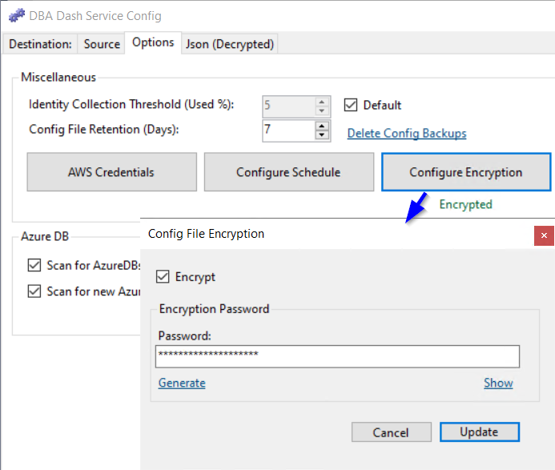

## Introduction

The configuration for the service is stored in JSON format in a file named **ServiceConfig.json** in the application folder.  You can edit this manually but it's recommended to use the **DBADashServiceConfigTool.exe** app (GUI) or **DBADashConfig.exe** (CLI) to ensure a valid configuration.  There is also a [commandTimeouts.json](/docs/help/query-timeout) file if you have customized any of the collection query timeouts.

## Protecting the config

To ensure your config file is protected:

* [Enable config file encryption](#encryption) (Starting 2.41.0).
* Use a strong password to encrypt the config.
* Avoid storing sensitive information in the config file if possible.

*e.g. Use Windows authentication where possible.  Use IAM roles to provide access to S3 buckets instead of access keys*

* Limit access to the config file.
* Review the [security](/docs/help/security) document and use the principal of least privilege.

### Secrets

Secret protection is stronger from version 4.23 onwards. Earlier versions only obfuscated passwords, which is not secure. An upgrade to 4.23 or later is recommended if you are on an older version.

Connection string passwords and the AWS secret key are encrypted with AES-GCM when the config is saved. Each value has its own nonce, so the same password on two connections is stored as two different values. Only authentication methods that take a password are treated as secrets.

On Windows, with [config encryption](#encryption) off, the key is a random machine key stored in the config (`MachineKey`) and protected with DPAPI for the local machine. Any process on that machine can decrypt the secrets. They cannot be decrypted on another machine. With config encryption on, the key is derived from the config password, so the secrets stay portable with that password and the machine key is removed.

On Linux and other platforms, DPAPI is not available. With config encryption off, secrets stay on the older obfuscation (`¬=!`). That passphrase is in the public source, so use config encryption wherever the file holds a password.

Values written by older versions are still read: plaintext, `¬=!`, `dpapi:` and an older encrypted config. The service re-protects secrets on start when an upgrade is needed, and the config tool does the same when it saves. A value the service cannot decrypt is left in the file and logged. Those connections are not collected, so the service does not keep trying a blank password. The service will not start if the destination password cannot be decrypted.

An older build of DBA Dash cannot read a config once its secrets have been re-protected. Keep the new build with the upgraded file.

[Full config encryption](#encryption) is the stronger protection. The whole file is encrypted, and once the temporary key is deleted it can't be read on the machine by anyone except the service account and the user that enabled encryption. Anyone else needs the password. This protection applies wherever the file is, so it's the better choice when the file has to leave the machine. The secrets stay portable too, because their key is derived from the password. The trade-off is that nothing can be recovered without the password.

A password pasted into the config tool, the CLI or the GUI is rejected when it is already a protected value. A protected value from another machine would leave the connection unusable.

## Encryption

Use the Options tab in the service configuration tool to enable encryption. Or enable encryption using:

`DBADashConfig -a Encrypt --EncryptionPassword "YourPasswordHere"`

[](config-file-encryption.png)

Backups of your ServiceConfig.json file are automatically generated and kept for 7 days by default. After you enable encryption you might want to <a href ='#config-file-backup'>remove old config files</a>

Enabling config file encryption encrypts the whole config file with a password. Current files use a version 2 envelope: PBKDF2-SHA256 with a random salt and 600,000 iterations, and AES-GCM. Secrets inside an encrypted config are protected with a key derived from the same password. The salt is kept while the password is unchanged, so saving the config does not rewrite the protected values on every save.

When encryption is enabled, the password is stored for your user account in the AppData folder, protected using the [DPAPI](https://en.wikipedia.org/wiki/Data_Protection_API).  You don't need to supply the password each time you load the configuration tool.  To allow the service account access to the config, a file containing the password is initially written to the application folder (ServiceConfig.TempKey).  This is protected using the DPAPI with the machine key and will allow anyone that can login to decrypt the password.  Once the service starts, the file is removed and the password is stored in the AppData protected using the DPAPI user key.  From that point only your user account and the service account will have access to the config.  If anyone else needs to access the config file, the password will be required.

The goals of this encryption solution were:
* Config file should be [portable](#moving-the-config).
* Provide enhanced protection to the whole config.
* Config file must be decrypted by multiple users.  e.g. DBAs & the service account
* Solution must not be tied to a specific cloud provider or external service.
* It should be as seamless as possible.

The saved file is a single protected value. Version 2 also stores the salt and the iteration count. Older encrypted files are a `ProtectedConfig` value on its own, and those are still read.

```json
{
  "Version": 2,
  "Salt": "<random salt>",
  "Iterations": 600000,
  "ProtectedConfig": "<AES-GCM ciphertext>"
}
```

The whole config file is encrypted and the decryption keys are protected. 

## Moving the config

**Export Config** on the service config tool writes a copy for another machine, or a backup. The running config is left as it is. Choose one of:

* Protect the secrets with an export password. On the new machine, supply that password when the file is opened.
* Leave the secrets out. Each one is replaced and listed to be entered again when the file is used.

The same actions are on the CLI. The export password can be passed as `--ExportPassword`, read from the `DBADASH_EXPORT_PASSWORD` environment variable, or read from standard input. A password supplied on the command line is stored in shell history.

```powershell
DBADashConfig -a Export --ExportPath C:\Temp\ServiceConfig.export.json
DBADashConfig -a Export --ExportPath C:\Temp\ServiceConfig.export.json --NoSecrets
```

An unencrypted config copied as a file uses a machine key, so its secrets cannot be decrypted on the new computer. The config tool lists those passwords in one grid. You can test each connection, and apply one password to every connection that uses the same login. The CLI lists them and sets them by connection or by login. `--Password` may be omitted when `DBADASH_PASSWORD` is set, or when standard input is redirected.

```powershell
DBADashConfig -a ListUnreadableSecrets
DBADashConfig -a SetPassword --ConnectionID "SQL1" 
DBADashConfig -a SetPassword --UserName DBADash
```

`--ConnectionID` is the source connection's ConnectionID, or `server|database` for a destination. It has to match one connection. `--UserName` sets every SQL connection that logs in as that user, which is also how a shared password is rotated.

If the config file is encrypted, copy `ServiceConfig.json` and supply the encryption password on the new machine. Secrets in an encrypted config are derived from that password, so they move with it. Click **Configure Encryption** and update to create the temporary key for the new service account. See [Move DBA Dash Service](/docs/setup/move-service/).

## Config file backup

Backups of the config file are created for you automatically and are kept for 7 days by default.  You can configure the retention on the **Options** tab of the service configuration tool.  If retention is set to 0, config file backup will be disabled.  You can click the  "Delete Config Backups" link to delete ALL config backups.

If you enable encryption you might want to clear out old config backups that are not encrypted.

Config backup files will be named similar to: `ServiceConfig.json.backup_20230612144737`

## GUI config

Starting with version 2.40.0, the **GUI** will initially use the connection defined in the ServiceConfig.json file if it's available.  The connection details will then be persisted on a per user basis in the AppData folder.  The connections are encrypted using the [DPAPI](https://en.wikipedia.org/wiki/Data_Protection_API).  Windows authentication avoids storing a password at all.
