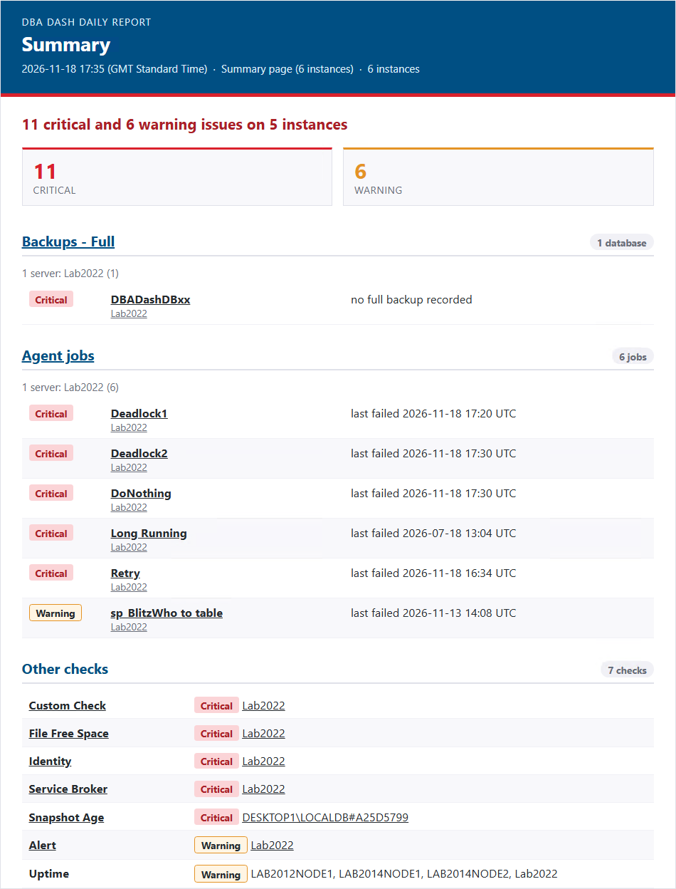


Daily reports are available in DBA Dash starting from 4.26.0.


Daily reports email a health summary of the instances in scope - all instances, or instances matching chosen tags - through an [email server](/docs/help/alerts/#email-servers) to one or more recipient addresses, on a schedule.  Each recipient gets their own copy. Manage them from **Alerts > Daily Reports**: add, edit, delete, preview or **Send now**.

## Creating a report

* Click **Add Report**.
* Set the scope (instance tags), the email server and recipients, the days of the week, the time and time zone to send at, or a repeat interval from every 15 minutes to 12 hours, until an optional end time.
* Choose a **full report**, or **changes only** - checks and alerts that are new, worse, better or resolved since the report's last send, with a brief summary of everything still open. Nothing is sent when nothing has changed, and the first run only records the starting point.
* Choose what to include: checks and object issues, open alerts, performance, charts, top queries, resolved issues, an AI summary, or plain text only.
* **Preview** shows what the next send would look like. **Send now** sends immediately. Neither updates the history used to work out what's changed - only a scheduled send does that.

## What's in the report

* **Checks and object issues** - critical and warning checks, marked new or ongoing (with how long), against the last scheduled report.
* **Open alerts** - Critical to Low, one per instance and alert key. Acknowledged alerts and alerts in a blackout are counted, not listed.
* **Performance** - exception-based, from the hourly rollups over the last 24 hours: CPU, read/write latency, critical/lock/other waits, blocking, deadlocks and slow/failed queries. Each is judged against the [Performance Summary](/docs/help/performance-summary/) thresholds and, optionally, against the median of the same weekday in 1 to 8 previous weeks. A report can be scoped to certain hours of the day (for example, 09:00-17:00) in a chosen time zone, and a breach can be left out when it's within the usual range for that hour, so a regular maintenance spike isn't reported. Listed instances can show small inline charts and the long running requests behind a finding (backups, DBCC, index maintenance).
* **Top queries** - CPU, IO latency and total/critical wait findings list the queries behind them, ranked by the increase in the finding's resource: CPU for CPU and waits, physical reads for read latency, logical writes for write latency.
* **Lead blockers** - blocking and lock wait findings list the sessions at the head of blocking chains, grouped by procedure, query hash or statement and ranked by the number of snapshots they led, with the most sessions and blocked wait in one snapshot and whether the session was sleeping with an open transaction.  Statement text is masked in the email and never sent to the AI.
* **AI summary** - an overview sentence and short bullet points from the DBA Dash AI service, using names and figures only, never query text.

## Summary page Report view

The **Report** toggle on the Summary page shows the loaded summary in the same layout (checks and object problems only - no performance, AI summary, alerts or history).  Section titles, items, server names and other-check names link to the matching tab in the app.

## Scheduling and delivery

* Reports are sent by the DBA Dash service with **Process Alerts** enabled (see [Service Config Tool](/docs/help/alerts/#service-config-tool)). The service checks every 5 minutes and claims reports that are due.
* A failed send is retried up to twice, 15 minutes apart. A report created after today's send time waits for tomorrow, and a service that was down catches up once.
* Every send records the mail server's reply (shown in the grid and in the Send now result), so an accepted message can be told apart from one that was never sent.

## Email servers

Reports are sent through an email server: shared SMTP settings (host, port, credentials and from address) that are also used by email notification channels.  See [Email Servers](/docs/help/alerts/#email-servers).
