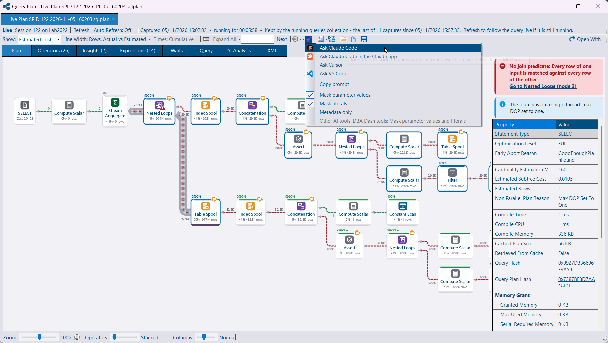
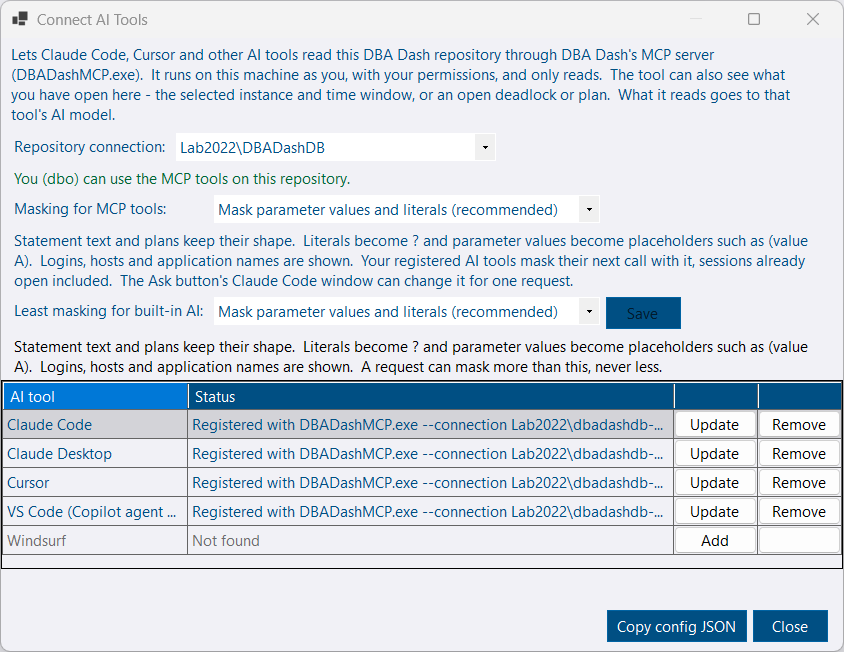
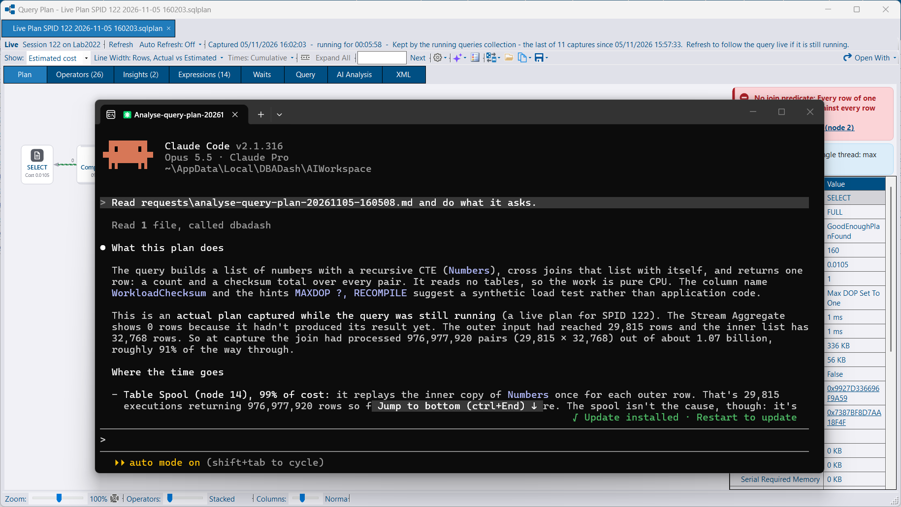
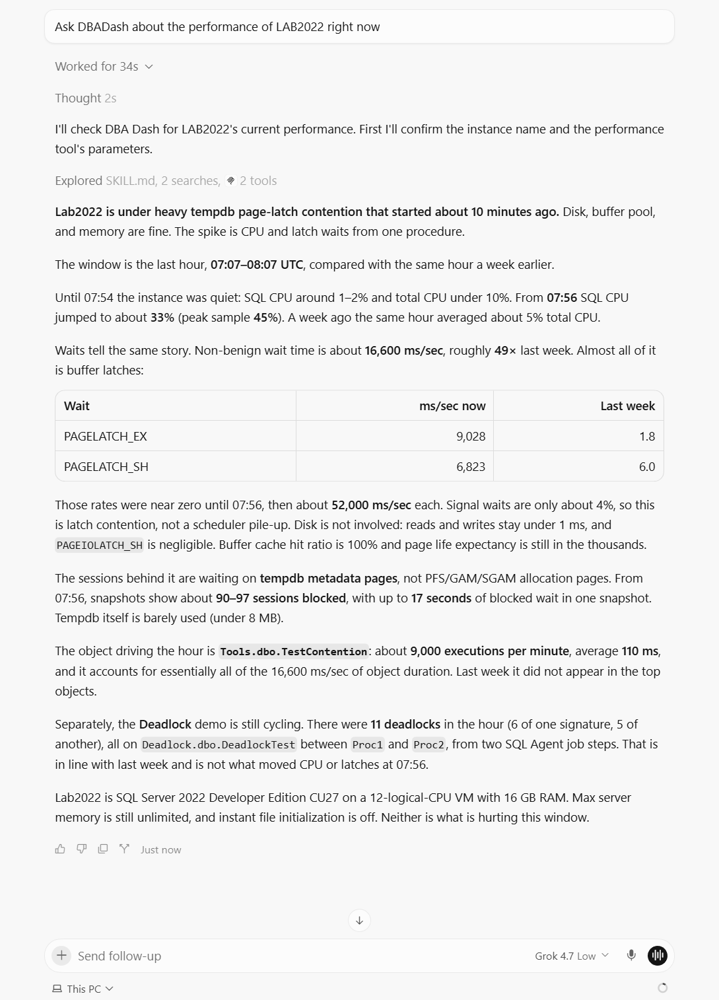

DBA Dash can act as a [Model Context Protocol](https://modelcontextprotocol.io) server. Claude Code, Claude Desktop, Cursor, VS Code and Windsurf can query the repository with their own model. The [AI Assistant](/docs/help/ai-assistant/) is not involved, and no AI provider has to be configured.

The tools are the same read-only summaries the AI Assistant uses (alerts, waits, blocking, slow queries, backups, drives, configuration drift, capacity), plus tools that return one deadlock, one query plan, query stats, or an instance's performance. They read the repository. They do not connect to the monitored instances.

[](mcp-analysis.png)

| | Local (`DBADashMCP.exe`) | Shared (`/mcp` on the AI service) |
|---|---|---|
| Needs the AI service | No | Yes |
| Transport | stdio (the client starts the exe) | Streamable HTTP |
| Repository identity | The user running the client | The AI service's account |
| Authentication | Your SQL permissions | The AI service API key |

## Connect it from the GUI

`DBADashMCP.exe` is installed beside the GUI. **Options > Connect AI Tools (MCP)** lists Claude Code, Claude Desktop, Cursor, VS Code (Copilot agent mode) and Windsurf. For each one it shows whether DBA Dash is registered, and can add, update or remove it.

[](connect-ai-tools.png)

* **Repository connection** is a saved GUI connection. The current one is selected. The exe reads `%AppData%\DBADashGUI\ConnectionStrings.json`, encrypted for your Windows user. With no saved connection it uses `ServiceConfig.json` beside the exe.
* The dialog checks that your login can use the tools. If it cannot, it shows `ALTER ROLE McpUser ADD MEMBER` for a DBA to run. See [Security](/docs/help/security/#dba-dash-gui).
* Claude Code is registered with `claude mcp add`. The other tools have their JSON config edited. Other servers in that file are kept, and the original is saved beside it as `.dbadash-backup`.
* **Copy config JSON** copies an `mcpServers` snippet for any other client.

Restart the tool, or start a new session, after adding the server.

```bash
claude mcp add dbadash -- "C:\Program Files\DBA Dash\DBADashMCP.exe" --connection "SQL01\DBADashDB"
```

`--connection` picks a saved GUI connection. `--list-connections` lists them. `--connection-string` uses a connection string instead.

Each session starts its own `DBADashMCP.exe`. It stops when that session ends, and when the process that started it exits. An upgrade stops copies running from the install folder before it replaces files.

## Ask from the GUI

[](claude-code-analysis.png)

An **Ask** button beside **AI Analysis** is on the deadlock viewer, the query plan viewer, and the Performance, Performance Summary, Latches and Spinlocks tabs. It hands that deadlock, plan statement, or instance and date range to a tool installed on the machine. The menu shows Claude Code, Claude Code in the Claude desktop app, Cursor, VS Code, and **Copy prompt**, for the tools that are installed and, where a registration is required, registered. The button is hidden when none of those apply.

Claude Code from Ask starts in `%LOCALAPPDATA%\DBADash\AIWorkspace` with its own MCP config, so a server you registered yourself does not get in the way. The deadlock or plan is written to `artifacts\` as its own file. Files there, and the MCP configs, are removed after a week. Cursor, VS Code and a pasted prompt use the `dbadash` server registered with that tool. You can also start from the tool: ask Cursor about an instance and it reads the repository through that server.

[](cursor-mcp.png)

## What the GUI is showing

On the local server, three tools read what the GUI is showing. The GUI publishes this on a named pipe that only your Windows user, in your logon session, can open.

| Tool | Returns |
|---|---|
| `get-gui-context` | The selected tree node, instance, database or object, the open tab, and the time window |
| `get-open-deadlock` | The deadlock open in the viewer, including one opened from a file |
| `get-open-query-plan` | The plan open in the viewer, and the statement selected in it |

If several copies of the GUI are open, the first one started answers. The tool warns when the GUI is on a different repository from the MCP server.

## Shared endpoint

The [AI service](/docs/help/ai-assistant/) serves the same tools at `/mcp`. In local mode the endpoint is on by default. In shared mode set `"Mcp": { "Enabled": true }`. The shared endpoint needs the same `X-API-Key` header as the rest of the API. Anyone with that key reads the repository as the AI service account.

The AI service role covers the summary tools, `list-deadlocks`, `get-deadlock` and `get-query-plan`. Add the service account to **McpUser** as well for object definitions on a deadlock and for `get-performance-summary`.

```bash
claude mcp add --transport http dbadash http://localhost:5055/mcp
claude mcp add --transport http dbadash https://aiserver:5055/mcp --header "X-API-Key: <key>"
```

## Tools

Summary tools take `instance` (display name prefix), `hoursBack` (usually defaulting to 24), `maxRows` (1 to 200, default 50) and, for tools with a time window, `to` (UTC). A list that comes back exactly `maxRows` long says so. Figures are rounded to 3 decimal places.

| Tool | Returns |
|---|---|
| `list-deadlocks` | Captured deadlocks, newest first |
| `get-deadlock` | One deadlock: participants, objects, findings, object definitions from schema snapshots, and the graph |
| `top-queries` | Query stats for the window, the same figures as the Query Stats tab |
| `get-query-plan` | A captured plan by `queryPlanHash`: statement, warnings, missing indexes, operators by cost |
| `get-performance-summary` | One instance over up to 7 days, compared with the week before |
| `get-root-blockers` | Root blockers in the worst blocking snapshots |
| `get-waiting-queries` | Queries waiting on a wait type. `tempdbOnly` limits this to tempdb pages |
| `get-long-running-queries` | The longest queries and open transactions in the snapshots |
| `get-deadlock-signature` | One deadlock pattern and its latest processes and resources |
| `describe-deadlock-graph` | A graph that is not in the repository. Pass the XML, or on the local server a `.xdl` path |
| `describe-query-plan` | A plan that is not in the repository. Pass the XML, or on the local server a `.sqlplan` path |

`describe-deadlock-graph` and `describe-query-plan` read only `.sqlplan`, `.xdl` and `.xml` files, under DBA Dash's folder or the folders the client allows. The shared endpoint does not read files unless `Mcp:AllowFilePaths` is set. A path would be on the service's machine, read as the service account.

Three prompts run the same analyses as the GUI: `analyse-deadlock`, `analyse-query-plan` and `analyse-performance`. In Claude Code they are slash commands. With no arguments on the local server, a prompt uses the open deadlock or plan, then the GUI's instance and window, then the most recent.

## Masking

Masking is on by default. Parameter values become placeholders, and the same value keeps the same placeholder. Literals in query text are masked. Metadata only withholds statement text and replaces logins, hosts and application names with codes.

`DBADashMCP.exe` follows the level saved in **Options > Connect AI Tools** (`%LOCALAPPDATA%\DBADash\McpDataDetail.json`), read on each call. `--data-detail` or `Mcp:DataDetail` fixes the level instead. An unknown value stops the server. An Ask from the GUI pins that request's masking, so a later Ask does not change a session that is already open.

## Output size

| Setting | Default | |
|---|---|---|
| `Mcp:MaxOutputChars` | 60000 | Maximum size of a tool result |
| `Mcp:MaxStringValueLength` | 2000 | Longer text, such as query text, is cut here |

For the AI service these go in `appsettings.json`. For the exe, put them in `DBADashMCP.json` beside the exe.

Tool results go to the model your MCP client uses. That can include instance names, query text, logins, hosts, parameter values and object definitions. Use a client and model you are allowed to send that data to. Masking reduces what is in the text. It does not change which model receives it.
