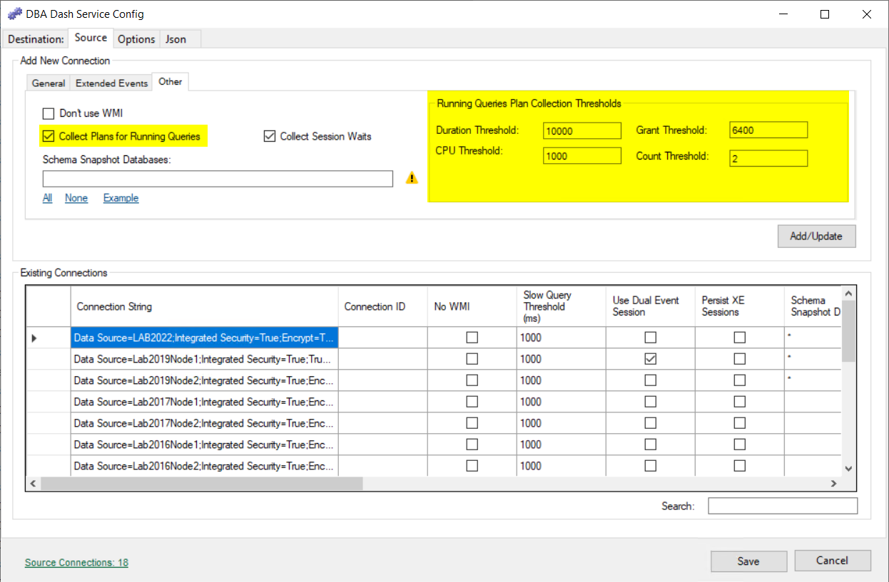

[RunningQueries](https://github.com/trimble-oss/dba-dash/blob/main/DBADash/SQL/SQLRunningQueries.sql) captures queries that are currently executing.  This takes inspiration from the likes of [sp_whoisactive](http://whoisactive.com/) and [sp_BlitzWho](https://github.com/BrentOzarULTD/SQL-Server-First-Responder-Kit/blob/dev/sp_BlitzWho.sql) - both of which are great tools.  It captures queries that are currently executing as well as sleeping sessions with open transactions.  This point in time snapshot might not be representitive of your SQL Server load but it provides a piece of the puzzle that can help diagnose performance issues.  For example, the data captured is useful to diagnose blocking issues, tempdb contention and memory grant issues.

## Enable Plan capture
Query plan capture is disabled by default.  To capture query plans, check the open in the DBA Dash Service Config tool:



The following json will be added to your source connection to enable the plan collection.  The thresholds can be modified by editing the json if required.  
```json
"RunningQueryPlanThreshold": {
"CPUThreshold": 1000,
"MemoryGrantThreshold": 6400,
"DurationThreshold": 10000,
"CountThreshold": 2,
"PlanCollectionEnabled": true
},
```
There is some extra overhead in capturing query plans but it can be useful to have this data available.  

## Efficient capture
DBA Dash focuses on providing lightweight collection of running queries to a central repository. In the [query](https://github.com/trimble-oss/dba-dash/blob/main/DBADash/SQL/SQLRunningQueries.sql) used to capture running queries, there is no call to sys.dm_exec_sql_text to capture query text or sys.dm_exec_text_query_plan/sys.dm_exec_query_plan to capture query plans.  Instead the query returns the sql_handle and query_plan_handle which can later be used to get the query text and plans.  

DBA Dash gets a distinct list of sql_handles and captures the associated query text.  If you have multiple instances of the same query running - the text will be collected and stored <ins>once</ins>.  The sql_handles of the text collected are cached.  If the same query appears in another running queries snapshot later - we won't need to capture the text for it.  This provides a more efficient way to capture and process running queries for regular collection.  

Capturing query text isn't generally that expensive but it can be a bit more expensive to capture query plans.  The cost isn't something to worry about for adhoc troubleshooting but we should pay attention for queries that run regularly.  DBA Dash doesn't collect plans by default so you can decide if you want to enable this feature.  If you decide to enable the feature, DBA Dash has an efficient method to capture query plans that you can tune for your needs. 

The system for capturing query plans is similar to capturing query text.  The plan_handle is captured with the statement start/end offsets which can be used to capture the query plans.  If you have multiple queries executing that are using the same plan - the plan is captured once.  Additionally, caching is done on the plan_handle in combination with the query_plan_hash and statement offsets. If we see the same plans in future running queries snapshots - we won't need to capture them again.   

Additionally thresholds are used for plan capture to reduce the overhead of collecting and storing plans that are unlikely to be of interest. By default, plans are not captured but if you enable plan collection these thresholds will be used:

 1,000ms CPU, 10,000ms Duration, 6400 pages (50MB) memory grant, query count: 2

Plans will be collected for queries that exceed **any** of the specified thresholds.  The thresholds can be configured in the ServiceConfig.json file.

## Live query plans

A request that is still running can be opened as a live plan, from Running Queries or from an [SSMS results grid](/docs/help/ssms-extension/#live-plans). **Live Plan** is on the session detail toolbar, and **Live Query Plan** is on the Running Queries context menu. The instance needs [messaging](/docs/help/messaging/#live-query-plans), and the user needs the **Messaging** role, the same as plan collection.

The plan XML is read once, from `sys.dm_exec_query_statistics_xml`, and opened in the [query plan viewer](/docs/help/query-plan-viewer/#live-plans). It is not stored. Each refresh reads the operator counters from `sys.dm_exec_query_profiles` — a few small rows — and writes them into the plan already open. The showplan is not fetched again, and a full plan XML is not written on each refresh. **Refresh** (F5) and **Auto Refresh** are on the Live bar. Auto refresh can be off or every 2, 5, 10 or 30 seconds, and defaults to 2 seconds. It pauses while the tab is hidden and stops after 30 minutes, after three failures in a row, or when the query finishes. The last capture stays on screen.

Zoom, pan and the properties grid stay put across a refresh. Operators that moved rows since the previous capture are highlighted. Statements such as `WAITFOR`, `BACKUP` and `DBCC` have no plan. Otherwise the instance needs lightweight query profiling, or the standard profiling that `sys.dm_exec_query_profiles` requires.

The request is read before and after the plan or the counters. If the statement changed while the capture was taken, that refresh is skipped, so the plan stays attached to the request you opened.

### Capturing long-running queries

The running queries collection can store those operator counters for long-running queries, so the plan can be opened later. Only the counters are stored. The plan XML is the one already kept by plan collection, once per plan shape. The option is off by default. On the running queries options, **Capture long running queries** sets:

| Setting | Default |
|---|---|
| CPU | 60,000 ms |
| Duration | 300,000 ms (5 minutes) |
| Max per collection | 10, highest CPU first |

A cleared threshold is unused. The query also has to meet the plan collection threshold above. A blocked query does not count towards the duration threshold. Only the counters are stored, one row per request, statement and plan. Each collection that still sees the query running replaces them and keeps the previous capture, which is how the viewer tells which operators were moving. The plan itself comes from the plan collection.

Where a capture exists, the plan link reads **View Live Capture**. Each capture opens on its own tab and does not refresh by itself. **Refresh** follows the query live if it is still running.

Captures are kept for the same number of days as running queries. A retention of 0 or less is not purged, so the running queries and the captures are both kept.
