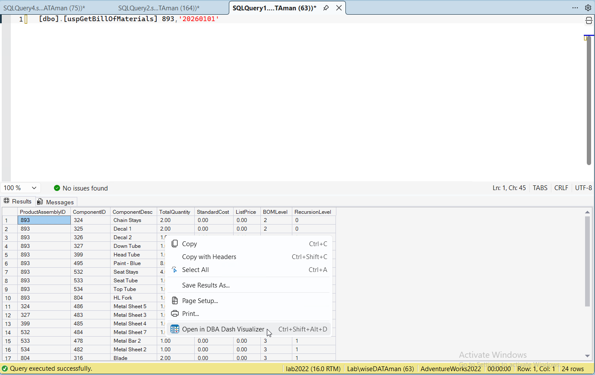
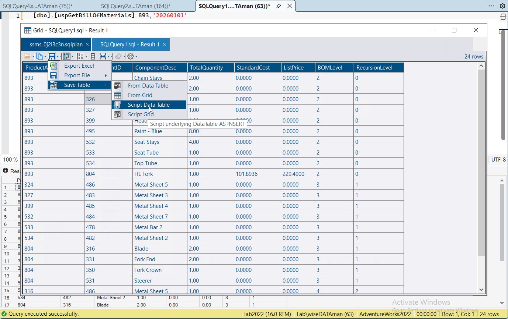
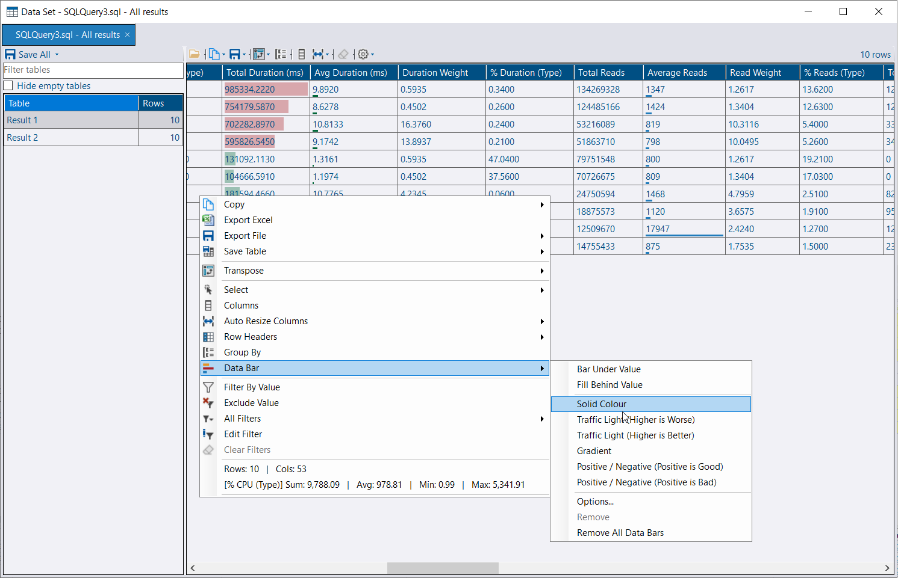
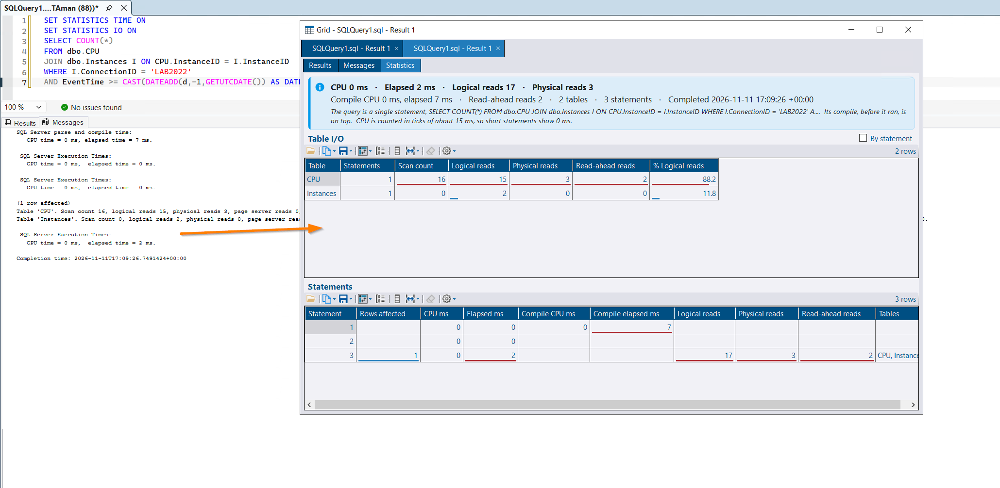
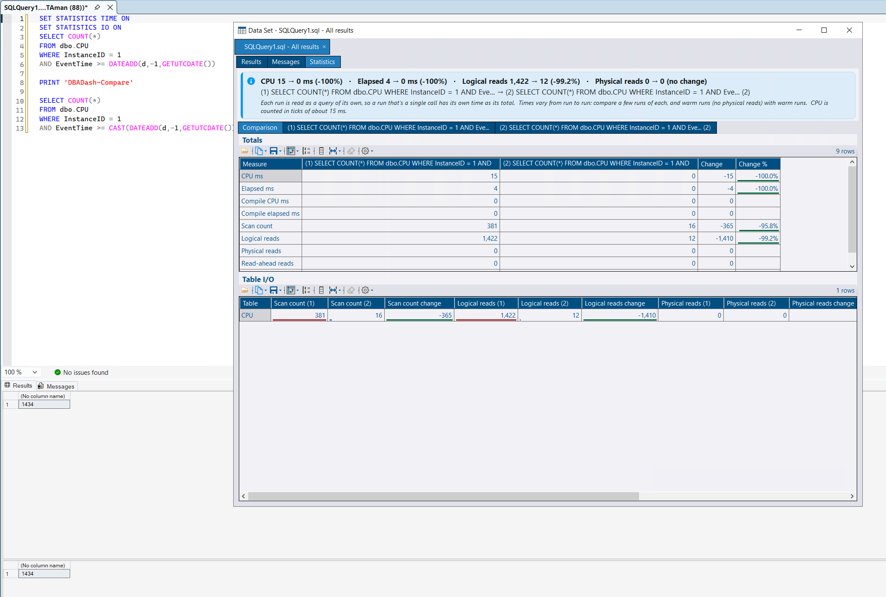
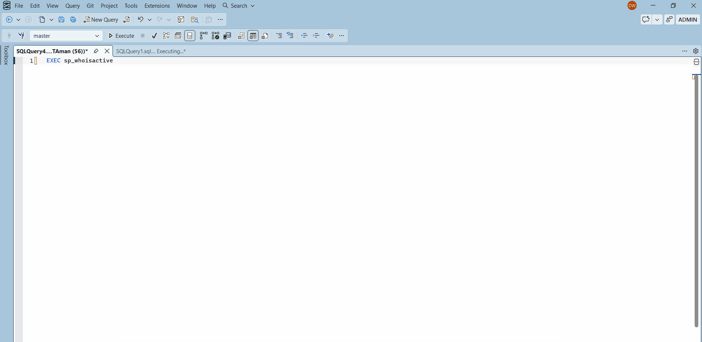


The SSMS extension is available starting from 4.20.1. It supports SSMS 21 and 22.


The extension adds an **Open in DBA Dash Visualizer** option to SSMS for:

* **Execution plans** - the execution plan right-click menu.
* **Deadlock graphs** - a right-click menu the extension adds to deadlock graph tabs.
* **XML** - a plain XML tab holding a plan or deadlock graph, such as the output from `sp_BlitzLock`.
* **Results grids** - the results grid right-click menu.
* **Live plans** - **Open Live Plan in DBA Dash Visualizer** on a results grid row that has a session id. See [Live plans](#live-plans).
* **All results** - **Open All Results in DBA Dash Visualizer** is shown when the query window has more than one results grid.
* **Messages** - **Open Messages in DBA Dash Visualizer** on the Messages tab's right-click menu. See [STATISTICS IO and TIME](#statistics-io-and-time).

The option is also on the **Tools** menu, with **Ctrl+Alt+Shift+D** as a keyboard shortcut.

[](ssms-extension.png)

Items open in [DBA Dash Visualizer](/docs/help/dba-dash-visualizer/). If the Visualizer isn't installed, they open in DBA Dash instead.

## Install

The extension is included with DBA Dash and DBA Dash Visualizer - there's nothing separate to download.

* **DBA Dash:** **Options > SSMS Extension > Install SSMS Extension...**
* **Visualizer (or DBA Dash viewers):** **Settings > Install SSMS Extension...**

The extension is installed with the SSMS VSIX installer. Close SSMS if prompted, and start it again once the install completes. Installing also records the path of the app it was installed from, which the extension uses to launch the viewer.

If the installed extension is older than the app, you'll be offered an update. Use **Uninstall SSMS Extension...** from the same menus to remove it.

## Results grids

[](results-grid.png)

Opening an SSMS results grid in the Visualizer gives you features that aren't available in SSMS:

* Sorting and filtering
* Group By
* Hide, show and reorder columns
* XML and JSON columns shown as links
* Plans and deadlock graphs in a cell open in their viewers
* Copy as Markdown, and export to Excel, JSON, XML, Markdown, HTML or SQL

Column data types are preserved when the grid is read from SSMS. Large result sets are read in the background with a cancellable progress dialog.

### All results

**Open All Results in DBA Dash Visualizer** sends every result set from the query window in one go. They open on a single tab, named after the query window, with a table per result set. **Save All** saves them as a data set file (XML or JSON) that can be re-opened later, or as an Excel workbook with a sheet per result set.

**Open in DBA Dash Visualizer** and **Open All Results** also send the query window's messages and the query text (SSMS 22). See [STATISTICS IO and TIME](#statistics-io-and-time).

### Data bars

[](data-bar.png)

Right-click a numeric column or cell and select **Data Bar** to draw a bar in each cell, sized by the value's share of the column's range.

* **Bar Under Value** or **Fill Behind Value**.
* **Solid Colour**, **Traffic Light (Higher is Worse)**, **Traffic Light (Higher is Better)**, **Gradient**, or **Positive / Negative**. Bars for negative values run left from a zero line, and bars for positive values run right.
* **Options...** sets the colors, a fixed minimum and maximum, and warning and critical thresholds. Select **Thresholds are values, not % of scale** to compare the thresholds with the cell value - e.g. amber from 5ms and red from 50ms.
* **Copy to All Numeric Columns** applies the same style to the other visible numeric columns. Each column keeps its own scale.
* **Remove** and **Remove All Data Bars** take bars away.

**Reset Data Bars** on the Data Bar menu puts back a table's own bars (such as the Statistics tab's) and forgets your changes.

By default, a bar is scaled to the values showing, so it rescales when you filter, group or refresh. Data bars are remembered and re-applied to the next result set with the same column names and types.

Data bars are available in grids throughout DBA Dash, not just result grids. They can also be saved with [custom reports](/docs/how-to/create-custom-reports/#data-bars).

### Script as INSERT

Right-click the grid and select **Save Table**:

| Option | Description |
|---|---|
| **Script Grid** | Script the visible columns, using the grid's column headers |
| **Script Data Table** | Script all the underlying columns |
| **From Grid** / **From Data Table** | Save directly to a table in a SQL Server database |

The script creates a `#DBADashGrid` temp table, inserts the rows (in batches of 1,000), and selects them back. Rows are filtered the same way as the grid.

```sql
IF OBJECT_ID('tempdb..#DBADashGrid') IS NOT NULL
BEGIN
    DROP TABLE #DBADashGrid
END
GO
CREATE TABLE #DBADashGrid (
    ...
);
INSERT INTO #DBADashGrid (...)
VALUES (...),
(...);

SELECT ...
FROM #DBADashGrid
```

Run the script in SSMS to re-create the results you saw in the grid, then query the temp table to slice the data further. This is useful for sharing a result set with someone else, or for keeping a copy of it to compare against later. **Export File > As SQL (INSERT)** saves the same script to a file.

### Saving and re-opening grids

**Export File** saves the grid as JSON or XML (optionally compressed), which can be re-opened later in the Visualizer or in DBA Dash with **Tools > Open Grid or Data Set**. Results saved from SSMS with **Save Results As** XML can also be opened - by drag and drop, from Explorer, or with the **Open** button. **Tools > Open Grid or Data Set** in DBA Dash also opens DataSets written to the DBA Dash service's `Failed` folder, which can help with troubleshooting collection issues.

## STATISTICS IO and TIME

[](statistics-parser.png)

With SSMS 22, results opened in the Visualizer bring the query window's **Messages** tab and the query text with them. **Open Messages in DBA Dash Visualizer** on the Messages tab's right-click menu (or the **Tools** menu) sends the messages alone, for a query with no results.

The document shows sub-tabs:

* **Results** - the result sets.
* **Messages** - the message text in the code editor, read only, with find (Ctrl+F, F3).
* **Statistics** - shown when `SET STATISTICS IO` or `SET STATISTICS TIME` printed anything.

The **Statistics** tab has a card with the query totals and a note on how far they can be trusted, table I/O by table (or by statement), and time, rows and reads per statement. The tables start with data bars. Counters are read by name, so counters added in new SQL Server versions become columns.



The query text is the text the window executed: its selection, or all of it, captured when the query starts. Editing the text afterwards doesn't change it. If the extension didn't see the query run, the editor's current text is sent and the card says it may have changed.

A single statement - a procedure call with or without `EXEC`, `sp_executesql`, `EXEC('...')`, or a `SELECT`/`INSERT`/`UPDATE`/`DELETE`/`MERGE` - has its own execution time taken as the total. It already includes everything it ran, so nested times aren't added up twice. A query with several calls shows its times as a range, from the longest single time up to everything added up, with a warning. Modifications note that triggers may be counted twice.



### Comparing runs

Add `PRINT 'DBADash-Compare'` (or `PRINT 'DBADash-Compare: label'`) before each version of a query to split it into runs:

```sql
SET STATISTICS IO, TIME ON;
PRINT 'DBADash-Compare: Before';
EXEC dbo.MyProc @Id = 1;
PRINT 'DBADash-Compare: After';
EXEC dbo.MyProc_v2 @Id = 1;
```

The **Statistics** tab then shows a card comparing the first run with the last, a **Comparison** tab with the totals and per-table I/O side by side with the changes, and a tab with each run's own statistics. A run with STATISTICS TIME or IO off is left blank rather than counted as 0.

[](statistics-parser-compare.png)

To compare across query windows, right-click a document tab that has statistics and choose **Compare Statistics With**.

### Saving messages

**Save Results and Messages...** (or **Save Messages...** when there are no results) on the Messages tab saves an XML data set that reopens on the same tabs, with the statistics read again. **Save All** on the Data Set view includes the messages too. JSON can't keep them marked as messages, so use XML.

## Live plans

[](live-plan-ssms.gif)

Right-click a row with a `session_id` or `spid` column, such as a result from `sp_BlitzWho`, `sp_WhoIsActive` or `sp_who2`, and choose **Open Live Plan in DBA Dash Visualizer**. The viewer follows that request as it runs. The plan XML is read once. Each refresh sends the operator counters, not another copy of the plan. See [Live query plans](/docs/help/running-queries/#live-query-plans).

The row is the one under the pointer. A right-click in SSMS does not change the selection, so the extension uses the cell that was clicked, and the selected row when the menu is opened from the keyboard. The session id comes from that row. When the grid also has `start_time` or `request_start_time`, that value is sent too, so a session that has moved on to another request is left alone.

The extension uses the query window's connection. Windows authentication and SQL authentication are supported. Microsoft Entra authentication is not supported yet. The connection is written to an `ssms_*.dbadashlive` temp file. The whole file is DPAPI-protected for the current Windows user. Any password is removed from the connection string and protected again inside the file, and the app holds it as a credential rather than as part of the connection string. The app accepts the file only from the extension's temp location, in the version it knows, and only when the file is less than 10 minutes old. It deletes the file as soon as it has been read. The extension deletes any of these files it wrote that are still there after 10 minutes.

The viewer then connects itself and runs the same SQL the DBA Dash service uses for a live plan opened from the GUI.

## How it works

The extension writes the plan, deadlock graph or grid data to a randomly named temp file and launches `DBADashVisualizer.exe` (or `DBADash.exe`). It finds the app by checking, in order:

1. The path recorded when the extension was installed.
2. DBA Dash's registered file associations.
3. The default Visualizer install location.
4. `PATH`.


SSMS doesn't provide a supported API for reading execution plans, deadlock graphs or results grids. The extension relies on SSMS internals, so a future SSMS update could break some of these options until the extension is updated. If the data can't be read, a warning message is shown.

