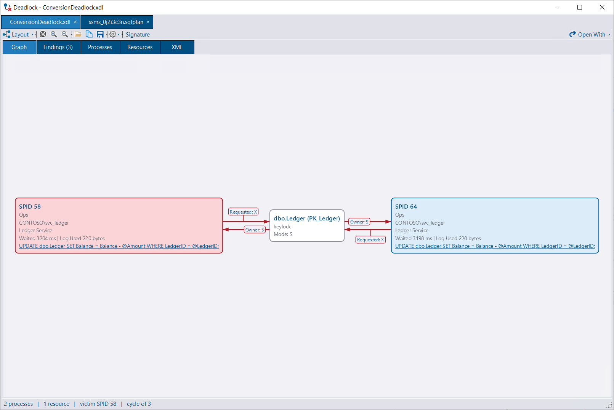
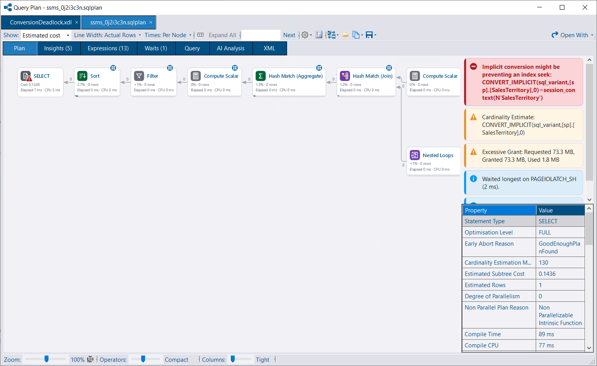


DBA Dash Visualizer is available starting from 4.20.1.


DBA Dash Visualizer is a small, standalone app containing the same viewers that are built into DBA Dash. It's for when you have a plan or a deadlock graph and don't have DBA Dash - no repository, service, SQL Server connection or monitored instance is needed.

* **Execution plans** (`.sqlplan`) - see [Query Plan Viewer](/docs/help/query-plan-viewer/).
* **Deadlock graphs** (`.xdl`) - see [Deadlock Viewer](/docs/help/deadlocks/#deadlock-viewer).
* **Result grids and data sets** - e.g. results sent from SSMS with the [SSMS extension](/docs/help/ssms-extension/).
* **JSON lines and Serilog logs** (`.jsonl`, `.ndjson`, `.clef`) - see [JSON lines and Serilog logs](#json-lines-and-serilog-logs).

Several files open as tabs of one window, so they can be compared.

[](visualizer.png)

[](visualizer2.png)

Features that need DBA Dash - AI analysis, collecting the current plan for a deadlocked statement from the instance, and Query Store lookups - aren't available in the Visualizer.

## Requirements

* 64-bit Windows 10 or later.
* [.NET 10 Desktop Runtime](https://dotnet.microsoft.com/download/dotnet/10.0) (x64). The setup program installs it if it's missing.

## Install

Download from the [latest release](https://github.com/trimble-oss/dba-dash/releases/latest).

### Setup program (recommended)

Run `DBADash_Visualizer_Setup_<version>.exe`. It installs in a few seconds for the current user only, so no administrator rights are required. There are no prompts to click through. It adds DBA Dash Visualizer to the Start menu and **Installed apps**, installs the .NET Desktop Runtime if needed, and updates itself.

### Install for everyone

Run `DBADash_Visualizer_Setup_<version>.msi`. It asks whether to install for you or for everyone, under Program Files. A silent install is per user unless `ALLUSERS=1`. An update of an install for everyone asks for administrator permission.

### Zip

Extract `DBADash_Visualizer_<version>.zip` to a folder of your choice and run `DBADashVisualizer.exe`.

<!-- TODO: restore once the winget package passes review
### winget

```bash
winget install Trimble.DBADashVisualizer
```

This silently runs the setup program, so it behaves the same way. `winget upgrade` also works. The package is added to the winget repository some time after each release.
-->

## Using it

* Run `DBADashVisualizer.exe` and choose a file, drag and drop files onto the window, or pass files on the command line:

  ```bash
  DBADashVisualizer.exe MyPlan.sqlplan MyDeadlock.xdl
  ```

* Files opened from Explorer, several at once, all open in the one running copy.

### JSON lines and Serilog logs


Available starting from 4.26.1.


JSON files are classified by their content. A single array or DataSet-shaped object loads as a DBA Dash grid or data set export, as before. A sequence of JSON values (JSON lines) loads as generic records: a column per property, with types inferred from the values and nested values shown as JSON. A column becomes a date only when every value in it reads as one.

Serilog compact (CLEF) records are recognised and laid out as a log: Timestamp, Level, Message, Exception, then the other properties. Messages are rendered from the message template when the rendered message isn't included.

A record that isn't valid JSON, such as a half-written last line, doesn't stop the file opening. Its text is shown in an **(Unreadable)** column with the error on its row, and a warning above the grid says how many parts couldn't be read. Files are opened with shared read/write, so a log that's still being written can be viewed.

### Open from Explorer

From the **Settings** menu of either viewer, select **Open .sqlplan Files with DBA Dash Visualizer** (or the `.xdl` equivalent) to add it to Explorer's **Open with** menu. Windows doesn't let an app make itself the default - select **Make DBA Dash Visualizer the Default** to go to **Settings > Default apps** and choose it there.

From the command line, use `--RegisterFileAssociation` and `--UnregisterFileAssociation`. This is per user and doesn't need elevation.

The DBA Dash GUI registers its own entry for the same file types, and both can be offered side by side.

### Start menu

The setup program adds a Start menu entry. The zip doesn't - select **Show in Start Menu** from the **Settings** menu, or run `DBADashVisualizer.exe --CreateStartMenuShortcut`. Use `--RemoveStartMenuShortcut` to remove it.

## Settings

Settings are stored per user in `%LOCALAPPDATA%\DBADash\Visualizer\settings.json`. Most are set from the viewers' **Settings** menus. Two are edited by hand:

| Setting | Values | Default |
|---|---|---|
| `Theme` | `Default`, `White`, `Dark` | Follows the Windows light/dark app setting |
| `CheckForUpdates` | `true`, `false` | `true` (also set from **About**) |

Logs are written to `%LOCALAPPDATA%\DBADash\Logs\DBADashVisualizer-<date>.log`.

## Updates

At most once a day, a few seconds after it starts, the Visualizer checks GitHub for a newer release.

* **Setup program or .msi:** select **Install Update**. The update downloads in the background and installs when you close the Visualizer. Only what changed is downloaded where possible. An install for everyone asks for administrator permission.
* **Zip:** select **Download**, then extract the new zip over the old folder (close the Visualizer first).

**Skip This Version** stops it mentioning that version again. Turn the check off in **About**, or check now with **Check for Updates** in the **Settings** menu.

## Uninstall

* **Setup program or .msi:** uninstall **DBA Dash Visualizer** from **Installed apps**. This removes the app, its Start menu entry and any **Open with** entries.
* **Zip:** first run `DBADashVisualizer.exe --UnregisterFileAssociation` and `--RemoveStartMenuShortcut` if you used them, then delete the folder.

Delete `%LOCALAPPDATA%\DBADash\Visualizer` to remove the settings.
