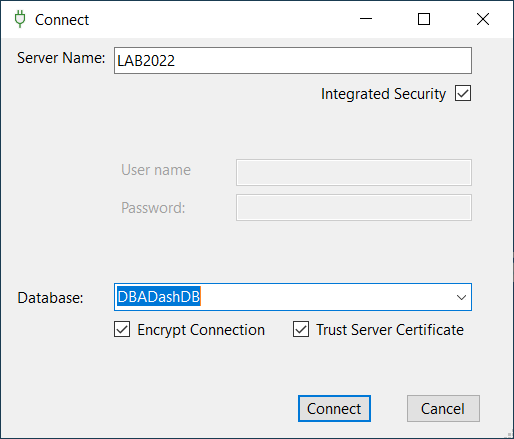

## Introduction

The GUI is packaged along with the DBA Dash service for convenience, but you might want to deploy this separately.

## Requirements

* 
[Download .NET 10 Desktop Runtime](https://dotnet.microsoft.com/en-us/download/dotnet/10.0/runtime)

*Note:*
* Versions 4.x use [.NET 10.](https://dotnet.microsoft.com/en-us/download/dotnet/10.0/runtime)
* Versions 3.x use [.NET 8](https://dotnet.microsoft.com/en-us/download/dotnet/8.0/runtime).
* Versions 2.x of DBA Dash use [.NET 6](https://dotnet.microsoft.com/en-us/download/dotnet/6.0/runtime).

`dotnet --list-runtimes`



* DBA Dash repository DB already [deployed](/docs/setup/quick-start).

## Security

To run the GUI, users only need access to the repository database.  No access is required to any of the monitored instances. Consider creating a group that grants access to DBA Dash.  To grant minimum permissions:

* Add the user/group to the "App" role in the DBA Dash repository database.  The role has SELECT and EXECUTE permissions.
* Optionally add the user to the ManageGlobalViews database role.  This allows users to save customized Metrics views for all users.

## Setup

Download from the [latest release](https://github.com/trimble-oss/dba-dash/releases/latest). Install the version that matches your repository. An installed GUI stays on the version of the repository it connects to.

### Setup program

Run `DBADash_GUI_Setup_<version>.exe`. It installs for the current user, with no administrator rights, and adds the GUI to the Start menu. When it connects to a repository on a different major or minor version it offers to install that version, an update or a downgrade. **Upgrade** in the About box installs the repository's exact version, including a patch release.

### Install for everyone

Run `DBADash_GUI_Setup_<version>.msi`. It asks whether to install for you or for everyone, under Program Files. A silent install is per user unless `ALLUSERS=1`. An update of an install for everyone asks for administrator permission. The SSMS extension finds an all-users install.

### Zip

1. [Download](https://github.com/trimble-oss/dba-dash/releases) the GUI_Only package
2. Extract it to a folder on your PC
3. Run DBADash.exe
4. Connect to the repository database.

A copy extracted from the zip is upgraded by the upgrade script, as before.

Use Windows authentication where possible.

The connection details are persisted on a per user basis in the AppData folder, encrypted using the DPAPI. The GUI will initially use the connection defined in the ServiceConfig.json file if it’s available (where the service is deployed).

 ## Upgrades

Users will automatically be prompted to upgrade if the GUI version is different from the repository. [See here](/docs/setup/upgrades/#upgrading-gui-clients)

 ## Other deployment options

 * Deploying the GUI to a network share is possible.  This might make upgrades harder with locked files though.
 * Deploying to a Google Drive is an option.
